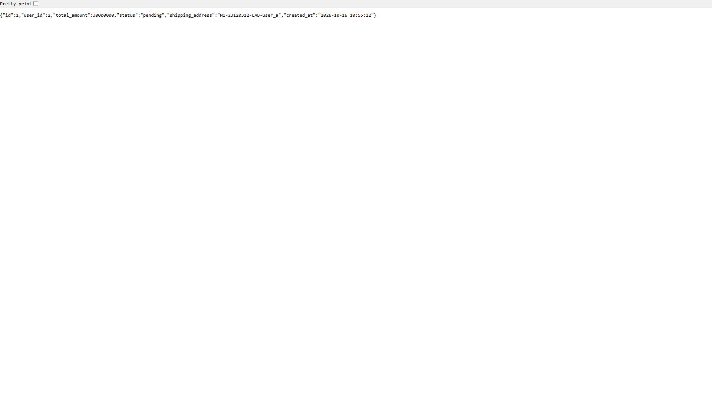
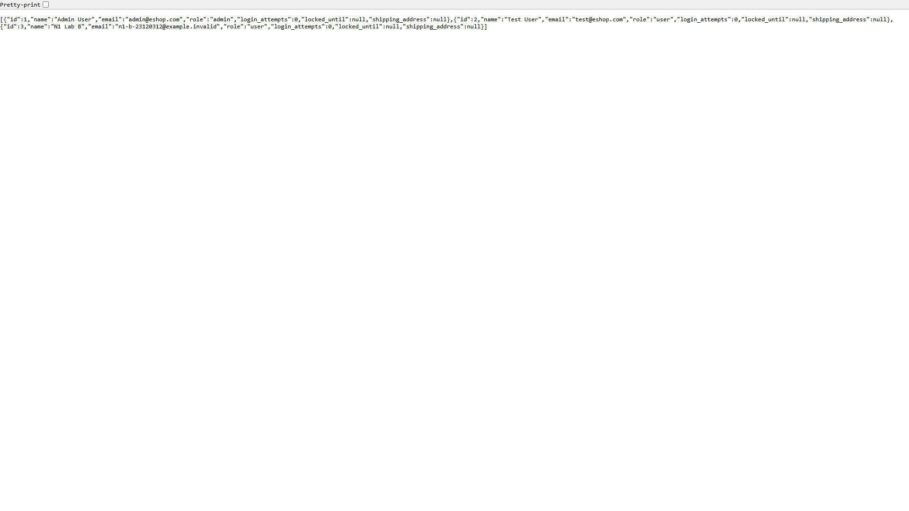

# N1: Kết quả kiểm chứng API trên main của nhóm

**Thạch Như – 23120312.**

Đây là lượt kiểm chứng HTTP thực do Codex thực thi bằng Node.js trước khi quay demo Burp.

- UTC: 2026-10-16T10:55:11.941Z
- SUT: https://github.com/KTPM2026/eshop-sut.git, commit ab5dd4f7ac0d8562800311dc94109939d3c6d930
- Công cụ: Node.js node:http; scripted API preflight; Node v24.11.1
- Backend: http://127.0.0.1:3000; NODE_ENV=development; source backend không sửa.
- Burp đã chạy: **chưa**. Nhãn độc lập N2 và benchmark AI N3: **chưa thực hiện**.
- Kết quả: **5 pass, 6 fail, 0 chưa đủ bằng chứng**, trên 11 ca.

## Kết quả từng ca

| Case | Actor | Owner/tài nguyên | Kỳ vọng | HTTP | Kết quả |
|---|---|---|---|---|---|
| N1-01 | user_a | user_a | allow | 200 | pass |
| N1-02 | user_b | user_b | allow | 200 | pass |
| N1-03 | guest | user_a | deny | 200 | fail |
| N1-04 | guest | user_b | deny | 200 | fail |
| N1-05 | user_a | user_b | deny | 200 | fail |
| N1-06 | user_b | user_a | deny | 200 | fail |
| N1-07 | guest | admin | deny | 401 | pass |
| N1-08 | user_a | admin | deny | 200 | fail |
| N1-09 | user_b | admin | deny | 200 | fail |
| N1-10 | admin | admin | allow | 200 | pass |
| N1-11 | user_a | none | deny | 404 | pass |

Mỗi ca có request/response đã làm sạch và giải thích checkpoint trong [results.json](results.json).

## Phát hiện được kiểm chứng

### N1-ACCESS-01: Đọc đơn hàng không đúng quyền

Guest và/hoặc user khác nhận đúng dữ liệu đơn lab đã tạo, gồm owner ID, địa chỉ và tổng tiền. Đối chứng owner đọc được đơn của mình. Cùng route GET /api/orders/:id được gom thành một phát hiện.

Ca liên quan: N1-03, N1-04, N1-05, N1-06.

### N1-ACCESS-02: User thường đọc API danh sách quản trị

Token role user nhận danh sách tài khoản lab tại GET /api/admin/users, đối chiếu cùng danh sách với admin control. Đã chứng minh quyền đọc, chưa kiểm tra sửa/xóa.

Ca liên quan: N1-08, N1-09.

## Ảnh response API từ trình duyệt

Ảnh Edge headless của response thật; JSON/status được đối chiếu với ca tương ứng. Đây chưa phải ảnh Burp.

## Giới hạn và bước tiếp theo

- SUT chạy ở commit main ghi trong báo cáo; ZAP export ngày 14/10 không ghi commit scan nên chưa chứng minh hai môi trường hoàn toàn trùng nhau.
- Burp chưa được cài/chạy; không dùng kết quả này để tuyên bố đã hoàn tất demo Burp.
- Lượt chạy do AI thực thi; Như cần tự rà soát, thao tác và thuyết minh theo yêu cầu chính chủ.
- Không phải ZAP export, nhãn độc lập N2 hoặc benchmark AI N3.
- Chỉ kiểm tra quyền đọc ở hai route; chưa đánh giá sửa/xóa hoặc ngoại lệ admin với đơn cá nhân.

Đây là bằng chứng API thực tế để Như/Hùng rà soát và làm nền cho N1; chưa xác nhận hoàn tất thao tác/quay Burp của sinh viên.
