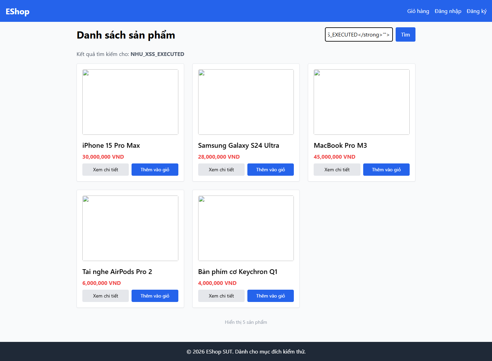
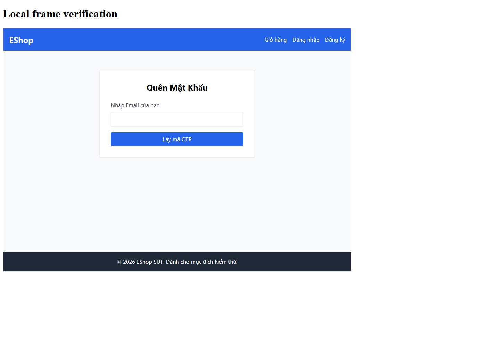

# N2: Như gán nhãn độc lập lần 1

**Đã có bản review Như được AI hỗ trợ theo yêu cầu mới, sau khi đọc bài Phát trong main `13f4d88`.** Xem ngay [bảng Như và đối chiếu Phát](assisted-review/doi-chieu-phat.md), [JSON](assisted-review/nhu-review.json), [CSV 29 ID](assisted-review/nhu-review.csv). Đây không phải nhãn người độc lập hay Ground Truth đã chốt. Không tạo phiếu/khóa thay Phát.

**Phiếu đang dùng:** theo yêu cầu của Như, đã điền [Nhu/private/nhu-labels.csv](../private/nhu-labels.csv) từ cùng bản review trên: 14 `true`, 10 `false`, 5 `unknown`, có ưu tiên cho nhãn đã kết luận, lý do và bằng chứng. Mỗi lý do có tiền tố `[AI-assisted]`; [metadata](../private/nhu-labels.provenance.json) ghi nguồn và hash. Hai CSV là hai cách trình bày cùng đề xuất, không phải hai lần đánh giá độc lập. `elapsed_seconds` để trống vì chưa đo; template `nhu-labels.blank.csv` vẫn trống. File private được Git bỏ qua; bản assisted chia sẻ vẫn ở các link trên.

## Bản review đã thực hiện

- Cùng thứ tự 15 nhóm gốc với Phát; **2 nhóm Google ngoài scope bị loại**, còn 13 nhóm EShop / 29 instance.
- Đề xuất theo nhóm: **6 Thật, 4 không phải lỗ hổng, 3 Chưa đủ**. Theo instance: **14 true, 10 false, 5 unknown**. Đây không phải 14 bug độc lập; nhiều instance cùng nguyên nhân, các header thiếu là hardening.
- Có 10 nhóm cùng kết luận sơ bộ với Phát; **#4 CORS, #8 Path Traversal, #13 token URL** còn chờ kiểm chứng chung. Không tự chọn nhãn Phát hay Như làm chuẩn.
- Đã chạy 15 request HTTP trực tiếp và các kiểm tra browser trên clone lab riêng ở `13f4d8847c44ec833f2eb6fdaf1b506e5037d0dc`; dependency cài từ lockfile. Source SUT không sửa, database làm việc của bạn không bị khởi động/reset.

### Minh chứng

[verification.json](evidence/main-13f4d88/verification.json) ghi UTC, commit, hash runner/source/ảnh, phiên bản Node/Edge/dependency, HTTP status/header, hash body và checkpoints. Không lưu token gốc, mật khẩu hoặc dump user. Browser chặn tài nguyên ngoài localhost; ảnh sản phẩm bị trống do chặn `placehold.co`, không chỉnh nội dung SUT để tạo bằng chứng.

| Kiểm tra | Kết quả quan sát |
|---|---|
| SQLi | Tên không tồn tại → 0 sản phẩm; `OR 1=1` → 5; `OR 1=2` → 0. Dấu nháy → 500 chỉ là dấu hiệu phụ |
| CORS | Browser đọc sản phẩm công khai khi omit credentials, không đọc được với include credentials; profile guest trả 401. Chưa chứng minh lộ dữ liệu riêng ở các instance alert |
| DOM sink / CSP | Thiếu CSP; payload tự nhập trong ô tìm kiếm chạy onerror, DOM tạo marker `NHU_XSS_EXECUTED`. Query URL không kích hoạt; chưa chứng minh attacker delivery tới nạn nhân, không gọi là cuộc tấn công XSS hoàn chỉnh |
| Framing | Trang quên mật khẩu render trong iframe từ origin khác; không gửi OTP hoặc thực hiện hành động nhạy cảm |
| Path Traversal | Chunk cũ và payload đều trả HTML fallback cùng hash root, không phải nội dung file ngoài thư mục; thiếu positive control asset scan cũ → unknown |
| Timestamp | Context React DOM cho thấy `lanes & 2080374784` chọn nhánh `Idle`: bitmask, không phải thời gian nhạy cảm của EShop |
| Token URL | Chỉ replay marker giả. Query giả cho cùng HTML; flow OTP hiện dùng JSON, chưa xác định nguồn/token scan → unknown |





Wildcard CORS cho tài nguyên công khai không tự chứng minh một lỗ hổng; trình duyệt có giới hạn riêng với credentials. Quyết định #4 dựa cả đối chứng local và [MDN CORS](https://developer.mozilla.org/en-US/docs/Web/HTTP/Guides/CORS), [PortSwigger CORS](https://portswigger.net/web-security/cors). Thiếu `nosniff` được ghi là điều kiện hardening, chưa phải MIME-sniffing exploit; chức năng header tham chiếu [MDN X-Content-Type-Options](https://developer.mozilla.org/en-US/docs/Web/HTTP/Reference/Headers/X-Content-Type-Options). CSP và frame policy tham chiếu [MDN CSP](https://developer.mozilla.org/en-US/docs/Web/HTTP/Reference/Headers/Content-Security-Policy), [MDN X-Frame-Options](https://developer.mozilla.org/en-US/docs/Web/HTTP/Reference/Headers/X-Frame-Options).

### Như và Phát cần xác nhận

1. Rà bảng đề xuất, thống nhất rubric có tính thiếu header/hardening là finding thật hay chỉ khuyến nghị. Nếu chỉ chấm lỗi khai thác được thì phải đổi rubric/nhãn và báo rõ, không dùng cùng tên chỉ số để so hai định nghĩa khác nhau.
2. Chốt #4 bằng policy/origin và kịch bản dữ liệu riêng; #8 cần response/asset đối chứng và commit scan cũ; #13 cần xác minh flow/loại token và request gốc, không đưa token vào bài chia sẻ. Thiếu căn cứ vẫn giữ unknown.
3. Xác nhận bộ để N3 dùng: bản Như hiện là 29 ID / 13 nhóm local giống phạm vi bài Phát, còn bundle Lân chỉ 11 ID API. Không trộn nhãn theo nhóm vào output theo instance thiếu mapping.

Theo yêu cầu mới, AI đã hỗ trợ phán đoán sau khi đọc phiếu Phát; **không đánh dấu `--confirm-independent` cho bản này**. CSV assisted có schema riêng và bị tool khóa độc lập từ chối; JSON bị scorer từ chối làm nhãn chuẩn. Nếu protocol vẫn đòi hai người độc lập, cần người review chưa xem các nhãn tham chiếu hoặc bộ blind mới; nếu nhóm chấp nhận AI-assisted thì ghi đúng sự phụ thuộc/giới hạn, không trình bày như đối chứng người độc lập. Nhãn chuẩn chỉ chốt sau khi hai bạn thực sự thống nhất.

Mốc UTC và milliseconds trong log là **thực thi tự động**, không phải thời gian bạn gán nhãn. Human timing chưa đo, giữ null/trống. Không hồi dựng thời gian đã qua. N1 Burp trực tiếp và N3 inference thật chưa được hoàn tất bằng lượt này.

### Tái lập

Không chạy backend trong workspace chính vì ứng dụng reset database khi khởi động. Dùng clone mới trong `Nhu/private`, checkout đúng commit, cài dependency và dùng browser module Playwright riêng:

```powershell
node Nhu/N2_gan_nhan/verify_local.cjs --sut Nhu/private/eshop-n2-13f4d88 --reset-lab --browser-module C:/Users/Acer/Desktop/seminar/Nhu/private/browser-tools/node_modules/playwright-core --output-dir Nhu/outputs/n2-verification-new
python -X utf8 -m Nhu.N2_gan_nhan.build_review --output-dir Nhu/outputs/assisted-review-copy
```

Thay đường dẫn Playwright theo máy nếu cần. Runner chỉ đọc HTTP/source và thử DOM không lưu XSS vào database; chỉ tạo/reset dữ liệu seed trong clone bỏ được, không dump users, tự đóng API/Vite/browser/harness khi xong. `build_review` tái xuất **cùng snapshot minh chứng đang lưu**, không tự chạy lại lab hoặc tạo ground truth. Mọi output phải mới, không ghi đè; `review_decisions.json` là đề xuất AI được kiểm tra/mapping về 29 ID qua provenance gốc.

## Bộ dữ liệu sẵn dùng

Nguồn: [ZAP export ngày 14/10/2026](../../alert/2026-10-14-ZAP-Report-.json), ZAP 2.17.0. File gốc có 31 instance trong 15 nhóm alert theo site; lọc còn **29 instance, 13 nhóm alert theo site** trên `http://localhost:3000` và `http://localhost:5173`. Hai instance Google ngoài scope bị loại, không truy cập/scan lại dịch vụ đó.

Phân bố risk: **2 High, 7 Medium, 10 Low, 10 Informational**. Đây là risk do scanner báo, không phải số lỗi thật hoặc ground truth. Một instance là một record; nhiều instance có thể cùng nguyên nhân.

| File trong [data/h1-20261014](data/h1-20261014) | Dùng cho |
|---|---|
| [a1-input.json](data/h1-20261014/a1-input.json) | Input A1 của Lân, chỉ localhost, đã che token bằng redactor/parser hiện có của Lân |
| [dataset.json](data/h1-20261014/dataset.json) | N2/P2/N3, cùng 29 ID với input A1, không có nhãn/ưu tiên AI |
| [provenance.json](data/h1-20261014/provenance.json) | Hash export gốc và input A1, phiên bản ZAP, mapping ID tới vị trí instance gốc, scope và số bản ghi loại |
| [nhu-labels.blank.csv](data/h1-20261014/nhu-labels.blank.csv) | Phiếu trống để Như làm riêng; không phải bài gán nhãn đã hoàn tất |

Dataset ID: `h1-zap-20261014-localhost-v1`.
Hash input A1: `5586507dc3cd3d292c7359df32760291a8eb2629cf115df88b9ecbefa751f5e7`.

`source_sha256` là hash bytes của **a1-input.json** mà Lân phải đưa vào A1; hash export Hùng riêng là `raw_zap_sha256`. Không chạy A1 trên raw export rồi sửa metadata cho khớp. Đổi scope/redaction/parser/ID cần tạo phiên bản dataset mới và khóa lại tất cả nhãn/run.

`.gitattributes` giữ nguyên bytes của pack và minh chứng khi clone trên Windows/Linux. Hash bytes của export/parser/redactor ghi môi trường đã dùng; các trường `raw_zap_content_sha256`, `normalizer_text_sha256`, `redactor_text_sha256` cho phép kiểm tra cùng nội dung khi Git đổi CRLF/LF. Hash input A1 vẫn luôn là hash bytes chính xác, không chuẩn hóa khi chấm.

Hùng đã có [setup_ZAP.md](../../setup_ZAP.md). Export chưa ghi chính xác commit SUT của scan và không chứa đủ full HTTP response cho mọi alert. Khi không đủ căn cứ, replay trên lab và lưu bằng chứng; không dùng risk/name làm kết luận.

## Quy trình độc lập

**Sau pull main ngày 18/10:** nhánh `origin/phat/labs-workspace` có bảng 15 dòng nhưng chưa cùng ID/định dạng khóa với pack này; module `ai/` của Lân trên main `d66c263` dùng 11 ID chỉ API 3000. Nhánh mới `feat(ai)/benchmark_offline` tại `f56c79f` có bundle 11 ID và hai phiếu trống, **chưa merge vào main**. Chưa được ghép trực tiếp. Thống nhất scope và đơn vị trước khi bắt đầu; không tự trải nhãn theo nhóm ra nhiều instance hoặc sửa hash cho khớp. Chi tiết ở [README Như](../README.md#việc-như-cần-tự-làm).

1. Như/Phát chốt scope, đơn vị instance và rubric trước khi đo. Mỗi người xem bằng chứng, không xem phiếu nhau hoặc output AI.
2. Như làm trên phiếu private. Với mỗi ID, ghi `true/false/unknown`, ưu tiên, lý do, bằng chứng và số giây thực đo. Trống nghĩa là chưa làm; thiếu bằng chứng dùng unknown, không ép false.
3. Khóa phiếu trước khi xem P2/AI. Cờ xác nhận là tuyên bố của người gán nhãn, tool không thể tự chứng minh tính độc lập.
4. Sau khi Phát cũng khóa, đối chiếu; hai người replay/chốt bất đồng thành nhãn chuẩn. Compare không tự chọn người đúng hoặc tự tạo ground truth.

Rubric theo đề xuất nhóm: P1 dễ khai thác/tác động cao; P2 dễ khai thác/tác động thấp; P3 khó khai thác/tác động cao; P4 khó khai thác/tác động thấp hoặc nghi false positive. **Nhóm cần duyệt trước khi dùng.** Alert thông tin không tự động là lỗi thật hoặc false positive; nhóm cần thống nhất cách gán và giải thích. Unknown có thể chưa có priority.

## Các cột phiếu

| Cột | Người kiểm thử ghi |
|---|---|
| `alert_id`, `risk` | Lấy từ dataset, không sửa |
| `is_real` | `true`, `false`, `unknown` |
| `priority` | P1–P4; unknown có thể trống |
| `reason` | Căn cứ kết luận hoặc lý do chưa đủ căn cứ |
| `evidence_ref` | Request/response/ảnh/log lab đã làm sạch, hoặc bằng chứng còn thiếu |
| `elapsed_seconds` | Giây thực đo, không dùng timing mẫu hoặc tự điền 0 |

Đo thêm thời gian xử lý thủ công end-to-end cho cùng tập alert đến danh sách cuối, tách khỏi tổng thời gian hai người tạo ground truth. Ghi rõ phạm vi setup/replay/adjudication, tránh so sánh hai công việc khác nhau.

## Phương án 11 ID theo bundle mới của Lân

Đã chuẩn bị tại `Nhu/outputs/lan-review-v1-api3000-f56c79f/`: `a1-input.json`, `dataset.json`, `nhu-labels.blank.csv`, `provenance.json`. Đây là **candidate, chưa đổi bộ dữ liệu đang dùng**. Không có nhãn người hoặc inference AI. Giữ bộ 29 ID và `Nhu/private/nhu-labels.csv` hiện tại nguyên vẹn; không trộn hai bộ.

Tool [import_bundle.py](import_bundle.py) đọc Git snapshot `f56c79f` của Lân, kiểm tra hash bytes file alerts, mapping với ZAP gốc, đủ ID/thứ tự và parser hiện tại. Không đọc hai file review của Như/Phát, không lấy nhãn của người khác. Input A1 của candidate là **đúng bytes của alerts.json Lân đã khóa**:

| Trường | Giá trị |
|---|---|
| Số record / origin | 11 instance / `http://localhost:3000` |
| `source_sha256` cho A1/N3 | `275f6d14f2f066fe4b1cda3d5ce18f70881e883c469e90ae1d16e6303eb917ea` |
| Hash raw ZAP trong manifest Lân | `fee6ce5be6ab6dc619ec23efa1b1054468c13a29f4847f4c6b27f5d8cad438bf` |
| `dataset_id` | `lan-review-v1-api3000-candidate` |

Hash raw ZAP của Lân khác hash input A1, **không sửa output A1 để đổi hash**. Tool ghi rõ nếu bytes source trong Git khác manifest chỉ do CRLF/LF; không chấp nhận thay đổi nội dung. Hash input A1 vẫn phải khớp exact bytes. Muốn tái lập, dùng thư mục output mới:

```powershell
python -X utf8 -m Nhu.N2_gan_nhan.import_bundle --ref f56c79f --output-dir Nhu/outputs/lan-review-v1-api3000-copy
```

**Chỉ sau khi Như/Phát/Lân đồng ý dùng bộ 11 này**, tạo phiếu private riêng và dùng cùng dataset cho timer/lock/N3:

```powershell
$dataset = "Nhu/outputs/lan-review-v1-api3000-f56c79f/dataset.json"
$reviewer = "Thạch Như - 23120312"
python -X utf8 -m Nhu.N2_gan_nhan.labels prepare --dataset $dataset --output Nhu/private/nhu-api11-labels.csv
python -X utf8 -m Nhu.N2_gan_nhan.timing labels --dataset $dataset --reviewer $reviewer --confirm-independent --scope-note "Review doc lap 11 ID API theo bundle Lan, khong tinh adjudication" --output-dir Nhu/private/api11-label-timings
```

Dùng tên riêng `nhu-api11-labels.csv`, `api11-label-timings`, `nhu-api11-labels.timed.csv` và `nhu-api11-labels.lock.json` cho các bước apply/lock bên dưới. Phát làm cùng 11 ID trên phiếu riêng, không tái sử dụng khóa 29 ID. Nếu nhóm giữ bộ 29, không cần dùng candidate này.

`alert/zap-alerts-auth.json` mới trong main có 24 record Informational của scanner, nhưng chỉ 2 ID khác nhau theo parser A1 hiện tại (22 record trùng identity). Không đồng nghĩa hai bug; file hiện bị parser từ chối ID trùng, chưa có provenance scan đầy đủ. Không tự deduplicate/gộp vào dataset để chạy được hoặc coi tên file là bằng chứng phiên xác thực thành công.

## Đồng hồ gán nhãn và review

[timing.py](timing.py) không gán nhãn, không đọc nhãn Phát/output AI và không hồi dựng thời gian đã qua. Chỉ bạn chạy tương tác trong terminal; không dùng thời gian AI đang sửa code làm thời gian của bạn. Sau khi nhóm chốt **giữ pack 29 ID** (nếu đổi scope thì tạo pack mới và thay đường dẫn), từ root repo:

```powershell
$dataset = "Nhu/N2_gan_nhan/data/h1-20261014/dataset.json"
$reviewer = "Thạch Như - 23120312"
python -X utf8 -m Nhu.N2_gan_nhan.timing labels --dataset $dataset --reviewer $reviewer --confirm-independent --scope-note "Doc bang chung, replay lab va dien CSV tung alert; khong tinh adjudication" --output-dir Nhu/private/label-timings
```

Mở phiếu `Nhu/private/nhu-labels.csv` bên cạnh. Công cụ hiện từng ID: Enter bắt đầu, bạn kiểm chứng và điền `is_real/priority/reason/evidence_ref`, Enter kết thúc. Để trống `elapsed_seconds` vì sẽ ghép từ đồng hồ. `q` rồi Enter hoặc Ctrl+C hủy interval hiện tại; các alert đã lưu vẫn giữ nguyên. Chạy lại cùng lệnh sẽ bỏ qua ID đã đo, không ghi đè. Không để đồng hồ chạy khi nghỉ; nếu hủy giữa chừng thì lần sau đo lại toàn bộ phần xử lý alert đó, ghi rõ giới hạn học lại. Không ghép nhiều phiên trùng/overlap để tăng thời gian.

Mỗi JSON giữ reviewer, ID/hash dataset, mốc UTC bắt đầu/kết thúc, số giây từ đồng hồ monotonic và phạm vi đo. Đây là nhật ký do người dùng vận hành, không tự chứng minh người thao tác hay tính độc lập. Chỉ xác nhận `--confirm-independent` nếu thật sự chưa xem P2/AI.

Sau khi đo đủ mọi ID, ghép thời gian vào **file mới**, không thay các nhãn hoặc file gốc:

```powershell
python -X utf8 -m Nhu.N2_gan_nhan.timing apply --dataset $dataset --reviewer $reviewer --sheet Nhu/private/nhu-labels.csv --records-dir Nhu/private/label-timings --output Nhu/private/nhu-labels.timed.csv
```

Tool từ chối thiếu/trùng ID, sai nguồn/reviewer, interval overlap, thời gian 0 hoặc thay ô thời gian có sẵn. `apply` chỉ ghép giây, chưa kiểm chứng nhãn; bước `lock` bên dưới vẫn kiểm tra đầy đủ nhãn/lý do/bằng chứng. Dùng **nhu-labels.timed.csv** cho `--sheet` khi khóa, giữ kèm JSON thời gian. Nếu bạn tự đo và đã điền giây bằng công cụ khác, giữ nhật ký gốc đó và khóa CSV đang có, không chạy `apply` để ghi đè.

Đo một pipeline thủ công end-to-end cùng scope, **không tự cộng thời gian Như + Phát + adjudication** làm đối chứng AI. Có thể mở terminal thứ hai, bắt đầu trước và kết thúc sau toàn bộ công việc thuộc protocol đã duyệt:

```powershell
python -X utf8 -m Nhu.N2_gan_nhan.timing record --dataset $dataset --reviewer $reviewer --purpose manual-total --scope-note "Cung scope xu ly thu cong tu alert dau den danh sach cuoi; ghi ro setup va nghi" --output Nhu/private/manual-total.json
```

`manual-total` đo liên tục, gồm cả thời gian chờ/nghỉ bên trong interval. Không dùng làm đối chứng nếu phạm vi không tương đương; để `manual_total_seconds` null và nêu hạn chế thay vì điền bù. Không tính trùng với các timer từng alert.

Chỉ **sau khi đã khóa hai phiếu và chốt nhãn chuẩn**, đo thời gian bạn thực sự review output của từng lượt AI:

```powershell
python -X utf8 -m Nhu.N2_gan_nhan.timing record --dataset $dataset --reviewer $reviewer --purpose ai-review --run-id a1-run-01 --scope-note "Doc va kiem chung toan bo output A1 run 01" --output Nhu/private/a1-run-01.review-timing.json
```

Mỗi lượt dùng run ID/output riêng; lấy `elapsed_seconds` từ JSON thật đưa vào `review_seconds` tương ứng trong manifest N3, chỉ bật `review_completed` sau khi đã review. `inference_seconds` vẫn phải do A1 đo lúc chạy, không đo lại từ cache. Chưa có dữ liệu thật thì giữ trống; các lệnh này chưa được chạy thay bạn để tạo timing người kiểm thử.

## Lệnh thực hiện

Các lệnh prepare/timing/lock cho review độc lập bên dưới chỉ áp dụng cho một phiếu mới thực sự độc lập. **Không chạy `--confirm-independent` với `Nhu/private/nhu-labels.csv` đã được AI điền**, kể cả sau khi đọc lại hoặc bổ sung thời gian. Dùng bản assisted và ghi đúng phương pháp nếu nhóm cho phép AI hỗ trợ.

Từ root repo, tạo phiếu riêng bằng lệnh sau (tool tạo thư mục và từ chối ghi đè):

Nếu đã có `Nhu/private/nhu-labels.csv`, tiếp tục điền file đó; không chạy lại cùng output hoặc xóa phiếu đang làm.

```powershell
python -m Nhu.N2_gan_nhan.labels prepare --dataset Nhu/N2_gan_nhan/data/h1-20261014/dataset.json --output Nhu/private/nhu-labels.csv
```

Như tự kiểm chứng/điền xong, chưa xem P2/AI, mới khóa:

```powershell
python -m Nhu.N2_gan_nhan.labels lock --dataset Nhu/N2_gan_nhan/data/h1-20261014/dataset.json --sheet Nhu/private/nhu-labels.csv --reviewer "Thạch Như - 23120312" --confirm-independent --output Nhu/private/nhu-labels.lock.json
```

Nhận bản khóa thật của Phát (không tạo thay Phát), rồi đối chiếu:

```powershell
python -m Nhu.N2_gan_nhan.labels compare --first Nhu/private/nhu-labels.lock.json --second Nhu/private/phat-labels.lock.json --output Nhu/private/disagreements.json
```

Compare báo bất đồng và độ khớp thô có tính unknown; không phải accuracy. Giữ CSV/file khóa nguyên bản và hash. Sau khi chốt mới dùng [hợp đồng nhãn chuẩn N3](../N3_benchmark_triage/README.md).

Tái lập pack từ export bằng parser A1 của Lân, không gọi model/mạng:

```powershell
python -m Nhu.N2_gan_nhan.prepare_zap --output-dir Nhu/outputs/h1-rebuilt
```

Tool kiểm tra scope cả site/instance, che secret theo parser Lân, không deduplicate, kiểm tra ID ổn định khi parse lại và không ghi đè. Bản chia sẻ vẫn cần người rà soát; raw export có giá trị token trong URL, không gửi trực tiếp cho model.

Sau pull, adapter dùng `ai.A1_ai_triage.parser`; provenance của **pack tạo mới** ghi đường dẫn/hash parser `ai/`. Pack 29 ID cũ vẫn giữ provenance lịch sử `Lan/`, không sửa hash cũ theo source hiện tại. Kiểm thử xác nhận parser mới vẫn tạo đúng 29 record/ID đã khóa và mock A1 vẫn không được tính thành benchmark.
