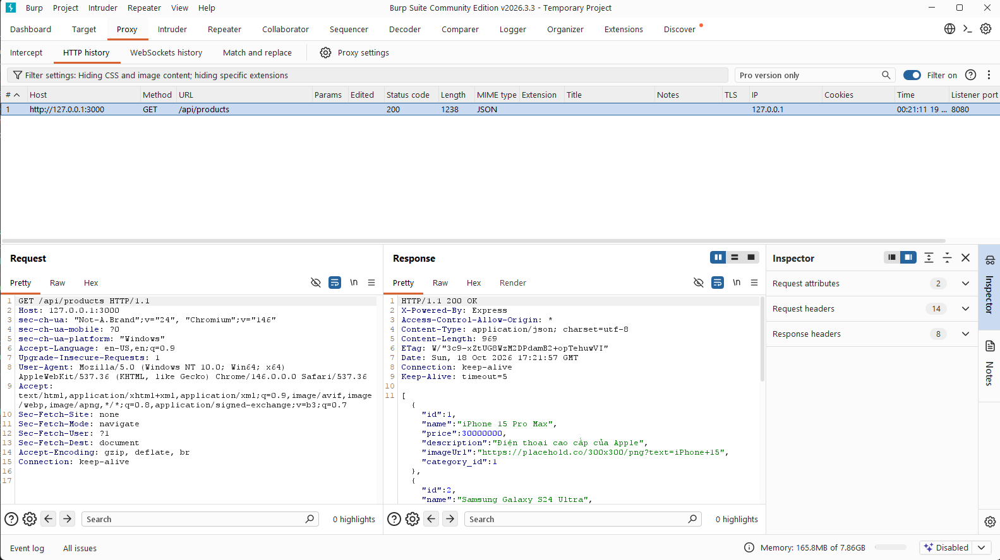
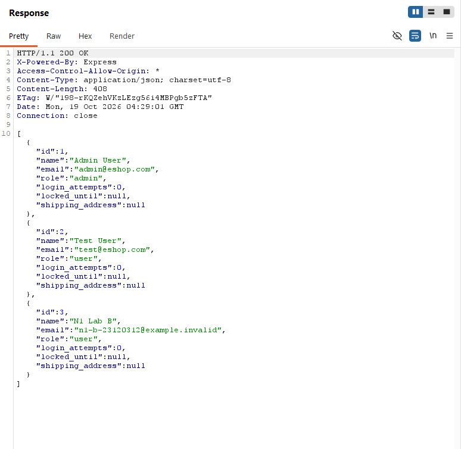

# Báo cáo thực nghiệm: Burp Suite và AI Vulnerability Triage

**Thạch Như - MSSV 23120312**

Lớp CQ2023/31. Học phần CS423 / CSC13003 - Software Testing, FIT@HCMUS.
Giảng viên: ThS. Trần Thị Bích Hạnh. Cập nhật: **20/10/2026**.

## 1. Tóm tắt

Phần thực nghiệm kiểm tra quyền đọc đơn hàng và API quản trị EShop, đồng thời đối chiếu đầu ra AI Triage với bản review của Như. Lượt kiểm chứng HTTP tự động có 11 ca, 5 đúng kỳ vọng và 6 vi phạm quyền, quy về hai phát hiện. Phiên Burp riêng có 11 ảnh Response, hai ảnh Proxy, một ảnh Scope và kết quả Intruder; giới hạn xác minh actor được giữ rõ, không lấy kết quả script thay cho thao tác Burp.

Ngày 20/10, ba output Triage live do Lân công bố được kiểm tra và đối chiếu trên cùng **11 ID API**, không trộn với toàn bộ 29 ID API/frontend. Theo xác nhận của Như, báo cáo chấp nhận **tham chiếu có AI hỗ trợ, không độc lập**. Precision/Recall/F1/Accuracy dưới đây là các chỉ số có điều kiện theo tham chiếu đó, không phải đánh giá trên ground truth độc lập. Không có kết luận tiết kiệm thời gian khi chưa đo người review.

## 2. Phạm vi và nguồn thực nghiệm

| Thành phần | Nguồn và điều kiện |
|---|---|
| SUT | [KTPM2026/eshop-sut](https://github.com/KTPM2026/eshop-sut), lab riêng, chỉ kiểm tra quyền đọc |
| Lượt HTTP N1 | Commit `ab5dd4f7ac0d8562800311dc94109939d3c6d930`, Node v24.11.1, Express 5.2.1, SQLite |
| Phiên Burp | Community 2026.3.3; scope `http://127.0.0.1:3000/`; ảnh do Như cung cấp ngày 19/10 |
| Danh tính lab N1 | Admin ID 1; A ID 2/đơn 1; B ID 3/đơn 2 |
| ZAP nguồn | [Export của Hùng](../../alert/2026-10-14-ZAP-Report-.json), metadata ZAP 2.17.0, scan `2026-10-14T12:03:34.601803939Z` |
| Review N2 | [29 ID và lý do/bằng chứng](../N2_gan_nhan/assisted-review/nhu-review.json), hỗ trợ AI sau khi tham khảo Phát; kiểm chứng riêng tại `13f4d88` |
| A1 live | [PR #5 của Lân](https://github.com/KTPM2026/eshop-sut/pull/5), chốt artifact tại `9fd85126f44a0b323c3b6b475a248bd409272c18` |
| Model/config ghi trong A1 | Adapter `openai`, endpoint Groq; model yêu cầu `qwen/qwen3.8-27b`, temperature 0, max completion tokens 1200, timeout 30 giây |

Phiên bản trong export và cờ live là provenance của người cung cấp, không phải chứng nhận độc lập từ dịch vụ AI. Chưa biết commit SUT chính xác tại lúc scan ZAP ngày 14/10; không gán commit lượt N1 cho lượt scan đó. Không sửa database chính hoặc thực hiện PUT/DELETE trong N1.

## 3. Kiểm chứng quyền truy cập N1

Ma trận dùng guest, A, B và admin, có đối chứng owner hợp lệ. Checkpoint phải đọc cả HTTP status và nội dung: order ID, owner ID, địa chỉ lab hoặc danh sách user/role.

| Ca | Thao tác | HTTP tự động | Kết luận lượt HTTP |
|---|---|---:|---|
| N1-01 | A đọc đơn A | 200 | Đúng kỳ vọng |
| N1-02 | B đọc đơn B | 200 | Đúng kỳ vọng |
| N1-03/04 | Guest đọc đơn A/B | 200 | Trả dữ liệu riêng trái quyền |
| N1-05/06 | A đọc đơn B, B đọc đơn A | 200 | Trả dữ liệu owner khác |
| N1-07 | Guest đọc API admin | 401 | Đúng kỳ vọng |
| N1-08/09 | User A/B đọc API admin | 200 | Trả danh sách user trái quyền |
| N1-10 | Admin đọc API admin | 200 | Đối chứng hợp lệ |
| N1-11 | A đọc đơn không tồn tại | 404 | Đúng kỳ vọng |

Nguồn: [JSON request/response đã làm sạch](../N1_burp/evidence/main-run-20261016/results.json), [CSV](../N1_burp/evidence/main-run-20261016/results.csv). Đây là lượt Node HTTP/Edge headless có ghi rõ người thực thi hỗ trợ, không phải kết quả Burp được suy ra từ script.

**Phát hiện 1 - đọc đơn không đúng quyền:** `GET /api/orders/:id` trả dữ liệu đơn cho guest hoặc user khác. Hướng khắc phục: xác thực và kiểm tra owner trên backend trước khi trả dữ liệu; giữ owner/cross-user/guest trong test hồi quy. Không suy ra quyền sửa/xóa.

**Phát hiện 2 - user thường đọc API quản trị:** `GET /api/admin/users` có xác thực nhưng thiếu kiểm tra role. Guest bị 401 còn token user đọc được danh sách. Hướng khắc phục: kiểm tra role phía server, dùng admin/user/guest làm đối chứng. Hai route được ghi thành hai phát hiện, không đếm mỗi ID/actor thành bug riêng. [Source SUT cố định](https://github.com/KTPM2026/eshop-sut/blob/ab5dd4f7ac0d8562800311dc94109939d3c6d930/backend/server.js).

### Phiên Burp do Như thực hiện

[Bộ ảnh và manifest](../N1_burp/evidence/burp-manual-20261019/README.md) có đủ 11 ảnh Response, Proxy Intercept/HTTP history và Scope. Intruder chạy payload `1`, `2`, đều trả 200 với body đơn 1/owner 2 và đơn 2/owner 3. Dòng 0 là baseline không sửa, không phải order ID 0.





Ảnh Response không tự chứng minh actor/token của request. Ảnh Intruder chọn payload 2 còn hiện request `/api/orders/1` trong khi response là đơn 2; cần đối chiếu cặp message gốc để chốt. Hai ảnh toàn Intruder chứa token giữ private. Vì vậy không nâng kết quả Burp thành 11 ca đã xác minh actor đầy đủ. XML không bắt buộc; có thể bổ sung ảnh cặp request/response đã che token hoặc log thật. Clip Burp gửi Long ghép video theo kế hoạch nhóm chưa có trong bộ bàn giao này.

## 4. Review N2 và điều chỉnh phương pháp

Export ZAP có 31 instance/15 nhóm; loại hai instance Google ngoài phạm vi, giữ 29 ID EShop thuộc API 3000 và frontend 5173. Bản review Như có **14 true, 10 false, 5 unknown**. Lý do, evidence và mapping nhóm/instance nằm trong [JSON/CSV N2](../N2_gan_nhan/assisted-review/).

Ngày 20/10, Như xác nhận chấp nhận phương pháp AI-assisted và ghi rõ không độc lập. Đây là xác nhận phương pháp qua trao đổi, **không phải biên bản họp, chữ ký của Phát hoặc xác nhận từng nhãn**. Không điền hai phiếu blank của Lân bằng cách giả người review đã hoàn tất. Không hồi dựng giờ bắt đầu/kết thúc của người.

Để khớp A1 live, lấy đúng 11 ID API từ bản 29 ID, không tự gộp tên alert hoặc thay ID. Tham chiếu 11 ID có **7 true, 1 false, 3 unknown**. Bảy true gồm một SQLi đã có đối chứng HTTP và sáu instance thuộc hai điều kiện header/hardening; không đồng nghĩa bảy bug khai thác độc lập. Ba CORS unknown được giữ nguyên và loại khỏi mẫu số classification.

## 5. Kiểm tra đầu vào A1 live

Input và ba output được sao chép nguyên bytes từ commit Lân vào [archive N3](../N3_benchmark_triage/evidence/live-20261020/README.md). Công cụ chỉ đọc artifact, không gọi model thêm hoặc tiêu tốn API. SHA256 từng file có trong `comparison.json`.

| Dấu vết input | SHA256 |
|---|---|
| Input 11 ID trong Git, LF | `275f6d14f2f066fe4b1cda3d5ce18f70881e883c469e90ae1d16e6303eb917ea` |
| Byte input CRLF được run live ghi nhận | `ef539a916009c976a2dcffc8028be270e7f9c45646299847fdda89f0d059e2e7` |
| ZAP gốc | `fee6ce5be6ab6dc619ec23efa1b1054468c13a29f4847f4c6b27f5d8cad438bf` |

Công cụ tính lại hai biến thể LF/CRLF và chỉ chấp nhận hash đã đối chiếu; không sửa metadata output để khớp giả. Kiểm tra đủ ID, schema sáu trường, completed/live/not-replay, cùng config/prompt/schema, run ID/timestamp khác nhau và response ID API không bị dùng lại. Các kiểm tra provenance không chứng minh tuyệt đối tính xác thực của dịch vụ bên ngoài.

## 6. Kết quả đối chiếu N3 trên output live

**Toàn bộ chỉ số trong mục này dùng tham chiếu AI-assisted không độc lập, không phải ground truth.** Có 8/11 nhãn tham chiếu đã kết luận, 3 unknown được báo riêng. AI abstain trên một nhãn true vẫn nằm trong mẫu số Recall/F1; abstain không được đổi thành false. Classification Accuracy và khớp ưu tiên là hai chỉ số khác nhau.

| Chỉ số theo tham chiếu assisted | Run 1 | Run 2 | Run 3 | Baseline risk |
|---|---:|---:|---:|---:|
| TP / FP / TN / FN kết luận false | 6 / 0 / 0 / 0 | 6 / 0 / 0 / 0 | 6 / 0 / 0 / 0 | 1 / 0 / 1 / 6 |
| Abstain trên true / false | 1 / 1 | 1 / 1 | 1 / 1 | 0 / 0 |
| Precision | 100% | 100% | 100% | 100% |
| Recall | 85,71% | 85,71% | 85,71% | 14,29% |
| F1 | 92,31% | 92,31% | 92,31% | 25% |
| Classification Accuracy | 75% | 75% | 75% | 25% |
| Classification coverage trên 8 nhãn rõ | 75% | 75% | 75% | 100% |
| Khớp ưu tiên | 12,5% | 12,5% | 12,5% | 25% |

Precision = TP/(TP+FP); Recall = TP/(TP+FN+abstain trên true); F1 = 2TP/(2TP+FP+FN+abstain trên true); Accuracy = (TP+TN)/8. Mẫu số 0 trả null. Baseline đề xuất: High/Medium là true, Low/Informational là false, với ưu tiên P1/P2/P3/P4 tương ứng. Baseline này không phải cách diễn giải chuẩn của risk ZAP và không phải nhãn người.

Ba lượt AI cùng phân bố 6 true, 0 false, 5 unknown; mean/min/max của các chỉ số bằng nhau. Không suy ra độ tin cậy thống kê từ ba lượt temperature 0 trên tập nhỏ nhiều instance trùng loại. Precision 100% chỉ có nghĩa 6 dự đoán true khớp tham chiếu hiện tại; không chứng minh AI không có false positive trên dữ liệu khác hoặc mọi header là lỗi khai thác được.

### Điểm cần phân tích thay vì chỉ báo điểm

- **SQLi:** tham chiếu true/P1 có thêm đối chứng SQL boolean trong [log kiểm chứng N2](../N2_gan_nhan/evidence/main-13f4d88/verification.json). A1 chỉ nhận evidence scan `500`, nên để null/P2. Đây là abstain trên một nhãn tham chiếu true và ưu tiên khác; chưa đủ để nói model sai khi không được cung cấp cùng lượng bằng chứng.
- **Hai nhóm header:** sáu instance `X-Powered-By`/thiếu `nosniff` cùng nhãn true nhưng A1 dùng P3, tham chiếu P4. Độ khớp classification cao bị chi phối bởi các điều kiện hardening lặp lại, còn khớp ưu tiên thấp.
- **Authentication Request Identified:** tham chiếu false/P4, AI null/P4. Khớp ưu tiên nhưng chưa kết luận classification; không đếm null thành TN.
- **CORS:** ba tham chiếu và ba dự đoán đều chưa đủ căn cứ. Không biến sự đồng thuận unknown thành ba ca phân loại đúng để tăng Accuracy.

## 7. Thời gian, lỗi API và chi phí

| Số đo từ artifact | Run 1 | Run 2 | Run 3 |
|---|---:|---:|---:|
| API calls thành công / lỗi | 11 / 3 | 11 / 0 | 11 / 0 |
| Tổng latency API được log, giây | 14,419 | 8,891 | 9,464 |
| Khoảng từ checkpoint đầu đến cuối, giây | 917,643 | 150,672 | 150,670 |
| Token được provider báo | 4.600 | 4.600 | 4.600 |
| Thời gian người review / tiết kiệm thời gian | Chưa đo | Chưa đo | Chưa đo |

Tổng 36 API call được ghi, 33 thành công, 3 lỗi; usage báo tổng 13.800 token của các lần thành công. Không biết token/chi phí tiền của những lần lỗi. Latency API không gồm toàn bộ throttle/I-O; khoảng checkpoint của run 1 có lỗi/resume và thời gian ngắt. Không lấy hai số đó thay thời gian toàn pipeline được đo hay thời gian con người. `human_review_seconds`, `manual_total_seconds`, `pipeline_seconds`, `time_saved_fraction` giữ null.

## 8. Giới hạn và kết luận

Đã có kết quả đối chiếu trên AI live thật được lưu trữ, không còn chỉ là fixture/synthetic. Tuy vậy, đây là đánh giá tham chiếu **không độc lập**, thay cho mục tiêu ban đầu dùng hai reviewer độc lập; không tuyên bố đã hoàn tất mục tiêu đối chứng độc lập. Chưa có chốt nhãn cuối của Phát, thời gian người thực đo, hoặc bằng chứng đầy đủ actor cho mọi ảnh Burp. Các thiếu hụt được công khai thay vì tạo nhãn/thời gian/clip giả.

Trong phạm vi đã đo, A1 hỗ trợ giữ các trường hợp thiếu bằng chứng và đề xuất ưu tiên, nhưng cần người bổ sung ngữ cảnh SQLi, quyết định rubric hardening và rà thứ tự ưu tiên. Báo cáo không kết luận AI thay người kiểm thử, tốt hơn baseline một cách tổng quát, hoặc tiết kiệm bao nhiêu phần trăm thời gian.

## 9. Tái lập và bàn giao

```powershell
git fetch origin
python -X utf8 -m Nhu.N3_benchmark_triage.live_review --ref 9fd85126f44a0b323c3b6b475a248bd409272c18 --accept-assisted-reference --output-dir Nhu/outputs/live-recheck-new
python -X utf8 -m unittest discover -s Nhu/tests -v
python -X utf8 -m unittest discover -s ai/tests -v
```

CLI từ chối ghi đè output, không tự sửa source/nhãn gốc và không gọi AI. [JSON đối chiếu](../N3_benchmark_triage/evidence/live-20261020/comparison.json) có công thức đếm, nhãn tham chiếu theo ID, cấu hình, timing và hash; [CSV](../N3_benchmark_triage/evidence/live-20261020/comparison.csv) để ghép bảng. Phần N4 này là báo cáo riêng để Phát ghép bài; clip Long, file slide theo mẫu nhóm và các xác nhận của người review là bàn giao riêng.

Nguồn phân công: [đề cương seminar N1-N4](https://github.com/KTPM2026/seminar/blob/main/docs/de-cuong-seminar.md), [AI proposal nhóm](https://github.com/KTPM2026/seminar/blob/main/docs/ai_proposal.md). Dữ liệu thực nghiệm ưu tiên các artifact được ghim commit và link nội bộ ở từng mục. [Nhật ký Như](../progress-log.md) ghi phần AI hỗ trợ.
