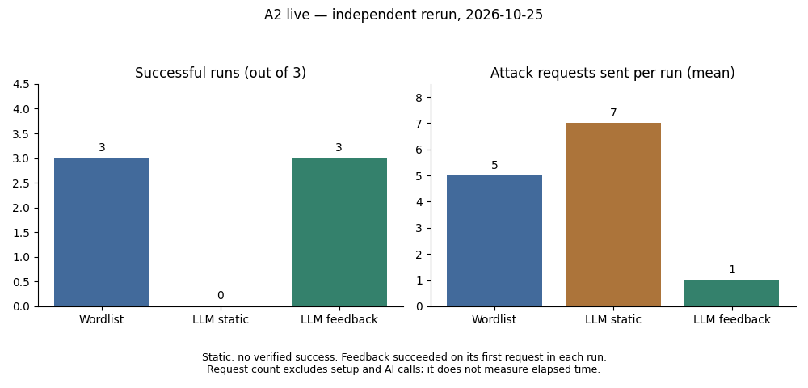

# A2 live — chạy lại độc lập ngày 25/10/2026

> Bản bàn giao mới nhất: [log người dùng tự chạy đủ 9 lượt](../A2_fuzzer_benchmark/results/live_manual_check_02.json) xác nhận feedback 3/3 với 4 request/lượt; xem [bản bàn giao](ban-giao-benchmark-2026-10-25.md). Phần dưới giữ kết quả của lần xác minh trước.

Lần chạy lại đã hoàn tất đủ ba lượt mỗi chiến lược: Wordlist 3/3, LLM static 0/3, LLM feedback 3/3. Feedback thành công ngay request đầu ở mỗi lượt. Kết quả hỗ trợ việc sửa giao diện/prompt giúp chiến lược chạy thành công trong lab này; chưa chứng minh lợi ích riêng của thích nghi theo phản hồi vì không cần lần đề xuất tiếp theo.

## Nguồn và điều kiện

- [Log gốc mới](../A2_fuzzer_benchmark/results/live_verify_2026-10-25_rerun.json), `status=completed`, đủ 9 row, `is_replay=false`, `model_inference_performed=true`.
- Commit code: `61e87bc3b272a55cf1b9366762fad1a0ed034212`, nhánh local `update/benchmark-results`, tách từ `origin/fix/llm-feedback-adaptation`.
- SHA-256 log: `3291a1caff1a3d044ca02ea350252067c168ec5530316b21824c24dbfb870947`.
- Model `qwen/qwen3.8-27b`, temperature 0, tối đa 1.200 completion token. Dùng cấu hình/key có sẵn trong `ai/.env`; không ghi giá trị key. Không xác minh được file/key đồng đội từng dùng.
- Lab H3/database tạm riêng; reset WAF level 1 mỗi lượt, xoay thứ tự chiến lược, trần 50 request tấn công/lượt, tối đa 10 feedback API call/lượt. Danh sách static có 7 ứng viên sinh một lần, dùng chung ba lượt.
- Snapshot nhất quán; source hash trước/sau khớp và đã được tính lại độc lập. Không đổi oracle, WAF, dữ liệu seed hay luật chấm điểm.

## So sánh với 20/10

| Chiến lược | Cũ: thành công | Cũ: request tấn công/lượt | Cũ: tổng tấn công / tổng SUT | Mới: thành công | Mới: request tấn công/lượt | Mới: tổng tấn công / tổng SUT |
|---|---|---|---|---|---|---|
| Wordlist | 3/3 | 5, 5, 5 | 15 / 27 | 3/3 | 5, 5, 5 | 15 / 27 |
| LLM static | 0/3 | 7, 7, 7 | 21 / 33 | 0/3 | 7, 7, 7 | 21 / 33 |
| LLM feedback | 0/3 | 1, 1, 1 | 3 / 15 | 3/3 | 1, 1, 1 | 3 / 15 |

Số request gửi không đổi so với lần cũ, nhưng kết quả feedback đã thay đổi: trước đây model dừng sau một request thất bại, lần này request đầu đạt oracle. LLM static vẫn hết ứng viên, không đạt; không được diễn giải 7 request là số request tới thành công.

Tổng mới: **39 request tấn công + 36 request phụ = 75 request SUT**. Mỗi lượt có 4 request phụ (reset, trạng thái WAF, snapshot, đối chứng không khớp). Request launcher chờ lab sẵn sàng nằm ngoài tổng này. AI có **4 call thành công**: 1 sinh danh sách static và 3 feedback, **1.529 token được báo**. Không suy ra chi phí tiền từ token khi chưa có đơn giá/hóa đơn được xác minh.



## Nhận định và giới hạn

Tuyên bố **feedback 3/3** được tái hiện. Con số **khoảng 4 request/lượt** chưa có log đồng đội để đối chiếu và không khớp lần chạy hoàn tất này: log mới ghi **1, 1, 1**. [Lần xác minh trước chưa hoàn tất](../A2_fuzzer_benchmark/results/live_verify_2026-10-25_partial.json) có một lượt feedback thành công sau 4 request rồi dừng vì API 429 ở lượt tiếp theo; giữ riêng, không ghép các lượt thành một benchmark giả.

Trong lần chạy hoàn tất này, feedback dùng ít hơn Wordlist 4 request tấn công/lượt (1 so với 5). Chưa kết luận nhanh hơn về thời gian hay rẻ hơn vì còn API call và giãn cách gọi model. Cả ba lượt feedback đều thành công trước khi nhận phản hồi WAF cho payload tiếp theo, nên chưa chứng minh cơ chế thích nghi tạo ra lợi thế. Ba lượt temperature 0 với cùng lab nhỏ không cho phép khái quát sang WAF, model hoặc website khác.

Prompt gợi ý sẵn kỹ thuật biến đổi và cả static/feedback dùng chung prompt; bối cảnh truy vấn/checkpoint được cung cấp từ thiết kế trước. Đây không phải đánh giá black box. Oracle vẫn là `proposed_sqlite_differential_v1`, `pending_group_review`; chưa đo XSS. Các điểm cần cải thiện về chuẩn hóa payload và chỉ dẫn chống prompt injection nằm trong [review code](kiem-tra-feedback-2026-10-25.md).

## Kiểm tra và tái lập

- Bộ test AI: 43/43 pass trong lần review; các test dùng API giả không thay thế số liệu live.
- Kiểm tra lại đủ run 1–3 từng chiến lược; số attack khớp độ dài attempts; tổng SUT khớp attack + phụ.
- Với từng thành công, tính lại oracle từ payload và ID quan sát được lưu trong log: đều đạt. Không có kiểm chứng HTTP 200 đơn thuần.
- Log không chứa giá trị key đang dùng. Log/cache 20/10 giữ nguyên, không bị ghi đè.
- [Summary mới](live-summary-2026-10-25.json) giữ nguyên dữ liệu triage 20/10 và dùng benchmark mới; không phải một lượt triage mới.

```powershell
# Chọn tên output chưa tồn tại cho lần chạy tiếp theo.
python -X utf8 -m ai.A2_fuzzer_benchmark.isolated_lab --mode live --runs 3 --budget 50 --output ai/A2_fuzzer_benchmark/results/live-next-run.json
# Cần matplotlib để vẽ biểu đồ; script từ chối log chưa hoàn tất và output đã có.
python -X utf8 ai/A4_slide_baocao/plot_benchmark.py --source ai/A2_fuzzer_benchmark/results/live_verify_2026-10-25_rerun.json --output ai/A4_slide_baocao/benchmark-next-chart.png
```

Log mới ở `results/` không bị ignore. Chưa commit/push/merge. Cần nhóm review oracle và ghép nội dung/biểu đồ vào file trình chiếu ngoài repo nếu có.
