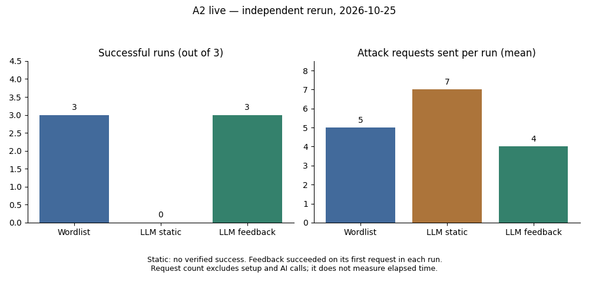

# Nội dung slide bàn giao — Lân; benchmark cập nhật 25/10/2026

Nội dung Markdown để Phát ghép vào mẫu chung. Nguồn: [triage lịch sử 20/10](bao-cao-live-2026-10-20.md) và [benchmark người dùng tự chạy 25/10](ban-giao-benchmark-2026-10-25.md).

## Slide 1 — Phần triển khai

- A1: chuẩn hóa ZAP, giữ ID, gợi ý phân loại và ưu tiên.
- A3a: cấu hình model, schema, redaction, adapter và log API.
- A2: benchmark wordlist/AI tĩnh/AI feedback trên H3 tách biệt.
- A3b: cache có hash, replay không gọi mạng.

Lời trình bày: “Em nối dữ liệu ZAP với model, kiểm tra bằng schema và giữ lại cho người review. Với Fuzzer, em đo từng request và checkpoint.”

## Slide 2 — Dữ liệu và model thật

- 11 instance từ origin `http://localhost:3000`; input/ID đã khóa hash.
- Groq, model `qwen/qwen3.8-27b`, OpenAI-compatible SDK.
- Temperature 0; tối đa 1.200 completion token; không tự retry/fallback.
- Output phải đúng schema và ID; chưa là quyết định cuối.

Lời trình bày: “Tên adapter là OpenAI, nhưng endpoint và model thực tế ở Groq. Em lưu model trả về, latency và usage từng call để truy vết.”

## Slide 3 — Kết quả Triage

- Inference thật trên đủ 11 ID, lưu từng lượt độc lập.
- Lượt 1: P2 = 1, P3 = 9, P4 = 1; true = 6, chưa kết luận = 5.
- Checkpoint giữ kết quả khi mất kết nối hoặc 429; resume chỉ chạy ID thiếu.
- Precision/Recall và thời gian tiết kiệm: chưa có nhãn/thời gian review để tính.

Lời trình bày: “Đây là phân bố dự đoán. Chưa thể nói có sáu lỗi thật vì còn cần nhãn độc lập và đối chiếu của Như/Phát.”

## Slide 4 — Thiết kế benchmark

- Lab sao chép H3, database tạm riêng; reset WAF level 1 trước mỗi lượt.
- Ba lượt/nhánh, xoay thứ tự; trần 50 request tấn công/lượt.
- AI tĩnh: sinh 7 ứng viên trước feedback, dùng lại cả ba lượt.
- Feedback: nhận lịch sử và checkpoint; tối đa 10 API call/lượt.
- Oracle so hiệu ứng SQLite với truy vấn parameterized; chỉ SQLi.

Lời trình bày: “HTTP 200 chưa chứng minh SQLi. Kết quả phải khớp truy vấn dễ lỗi và khác truy vấn an toàn trên cùng snapshot.”

## Slide 5 — A2 live: feedback đạt 3/3, 4 request/lượt

| Nhánh | Đạt oracle | Request đến thành công | Tổng request tấn công |
|---|---:|---|---:|
| Wordlist | 3/3 | 5, 5, 5 | 15 |
| LLM static | 0/3 | Chưa đạt; gửi 7 ứng viên/lượt | 21 |
| LLM feedback | 3/3 | 4, 4, 4 | 12 |



- Nguồn: `live_manual_check_02.json`, đủ 9 lượt, không replay.
- Tổng **84 request SUT = 48 tấn công + 36 phụ**; không gồm request launcher chờ sẵn sàng.
- AI: **13 call thành công**, 7.906 token được báo; chưa kết luận chi phí tiền.
- Feedback: 200 → 403 → 200 → 200; chỉ request thứ tư đạt oracle ở cả ba lượt.
- Dùng 4 so với 5 request tấn công/lượt của Wordlist; chưa kết luận nhanh hơn về thời gian.
- Kết quả thay đổi giữa các lần chạy: lần xác minh trước là 1 request/lượt, giữ log riêng. Chưa tách đóng góp riêng của prompt, chuẩn hóa và feedback.

Lời trình bày: “Lần em tự chạy lại xác nhận feedback đạt oracle ở cả ba lượt, mỗi lượt bốn request tấn công, so với năm request của Wordlist. Model tiếp tục sau khi bị WAF chặn; HTTP 200 đơn thuần vẫn không được tính thành công. Kết quả cho thấy ít request hơn trong cấu hình lab này, chưa chứng minh nhanh hơn về thời gian hay tốt hơn trên mọi WAF.”

## Slide 6 — Demo có thể tái lập

```powershell
python -X utf8 -m ai.A3b_video_cache.artifacts --source ai/A3b_video_cache/cache/triage_live_2026-10-20_run1.json --replay
python -X utf8 -m ai.A3b_video_cache.artifacts --source ai/A3b_video_cache/cache/fuzzer_live_2026-10-20_v1.json --replay
```

- Hai lệnh trên phát lại cache ngày 20/10, gồm kết quả feedback 0/3 lịch sử; không dùng chúng để minh họa số liệu Slide 5 ngày 25/10. Log bàn giao: `ai/A2_fuzzer_benchmark/results/live_manual_check_02.json`.
- Gắn nhãn **PHÁT LẠI KẾT QUẢ ĐÃ LƯU** khi trình chiếu.
- Kiểm tra hash; thiếu cache không tạo phiên thành công.
- Quay input, lệnh chạy, output ID và checkpoint; không quay `.env`.

## Slide 7 — Giới hạn và bàn giao

- Dataset nhỏ, model/prompt cụ thể, temperature 0; chưa đánh giá XSS.
- Oracle cần nhóm rà soát; chưa có nhãn N3/thời gian người review.
- 43 test kiểm tra phần mềm; chất lượng model cần nhãn riêng.
- Đã có code, inference, benchmark, cache và báo cáo; còn review, clip L3 và mẫu slide chung.

Lời trình bày: “Pipeline đã chạy được và log kiểm tra lại được. Chưa đủ dữ liệu để kết luận độ chính xác hoặc tiết kiệm thời gian cho người kiểm thử.”
