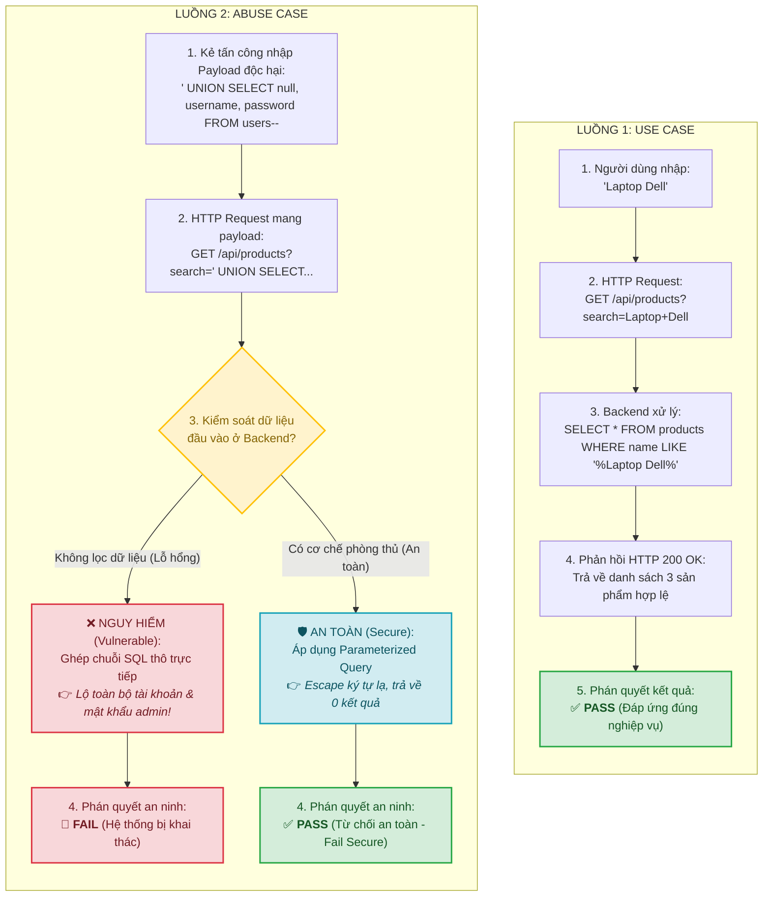
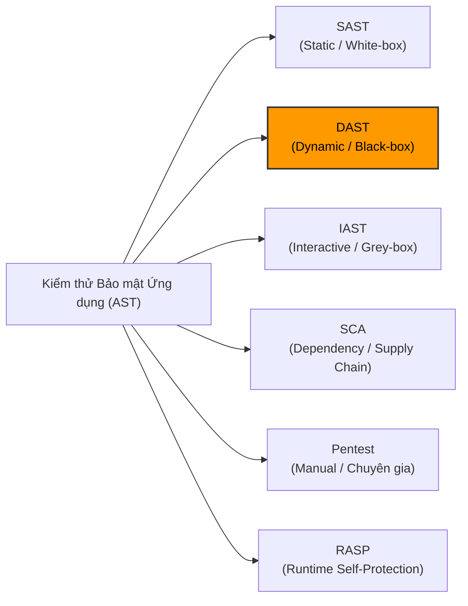
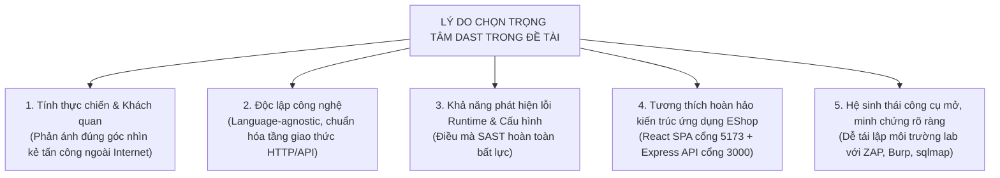
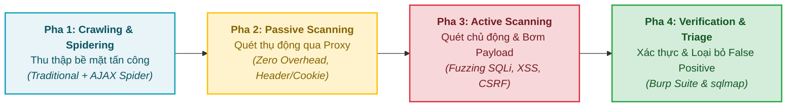
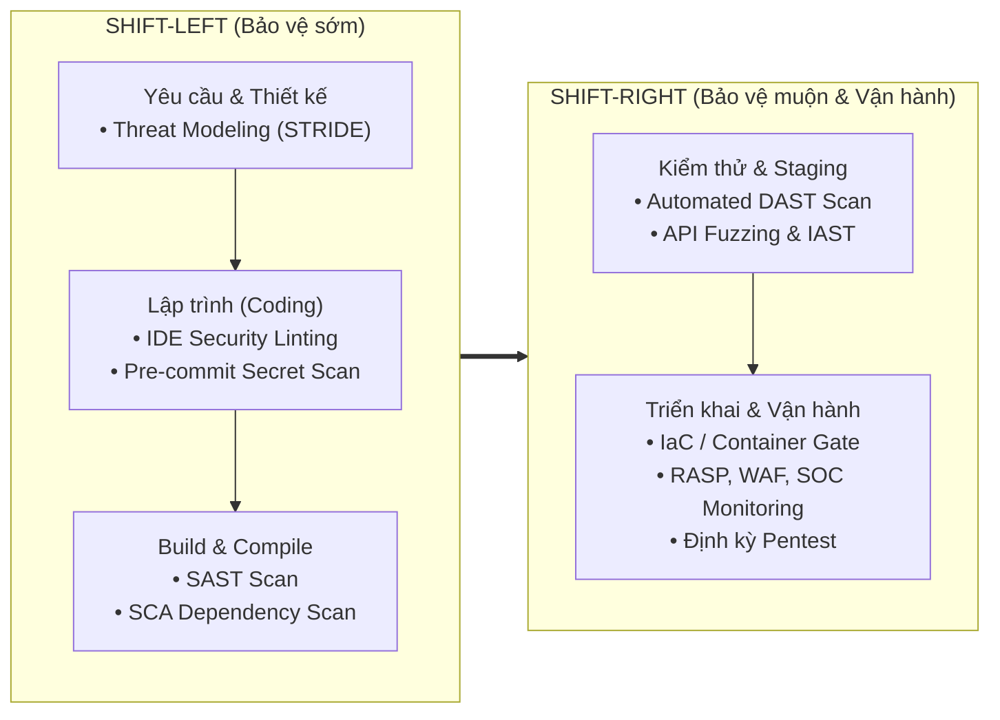
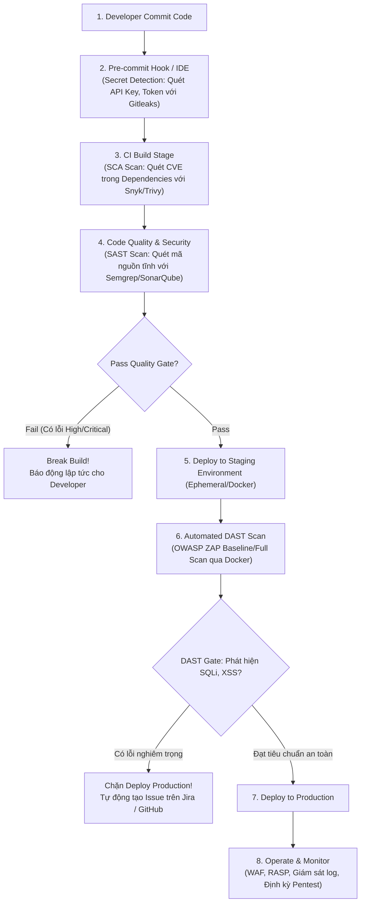

# TỔNG QUAN TOÀN DIỆN: SECURITY TESTING & DEVSECOPS

> **Chuyên đề:** Security Testing for Web Applications  
> **Môn học:** Software Testing (Kiểm thử phần mềm) — FIT@HCMUS  
> **Mục tiêu tài liệu:** Cung cấp hệ thống lý luận học thuật, phân loại kỹ thuật, biện luận phương pháp và quy trình triển khai DevSecOps hoàn chỉnh, đóng vai trò tài liệu cơ sở phục vụ báo cáo chuyên đề và triển khai thực nghiệm.

---

## 📌 MỤC LỤC
1. [Bản chất cốt lõi của Security Testing](#1-bản-chất-cốt-lõi-của-security-testing)
   - 1.1. [Khái niệm & Định nghĩa chuẩn hóa](#11-khái-niệm--định-nghĩa-chuẩn-hóa)
   - 1.2. [Mối quan hệ giữa Security Testing và các loại hình kiểm thử khác](#12-mối-quan-hệ-giữa-security-testing-và-các-loại-hình-kiểm-thử-khác)
   - 1.3. [Chuyển dịch tư duy: Từ Use Case sang Abuse Case & Misuse Case](#13-chuyển-dịch-tư-duy-từ-use-case-sang-abuse-case--misuse-case)
   - 1.4. [Mô hình hóa mối đe dọa (Threat Modeling) theo chuẩn STRIDE](#14-mô-hình-hóa-mối-đe-dọa-threat-modeling-theo-chuẩn-stride)
   - 1.5. [Bài toán phán quyết kết quả (Test Oracle Problem) trong Security Testing](#15-bài-toán-phán-quyết-kết-quả-test-oracle-problem-trong-security-testing)
2. [Phân loại toàn diện các phương pháp kiểm thử bảo mật (AST)](#2-phân-loại-toàn-diện-các-phương-pháp-kiểm-thử-bảo-mật-ast)
   - 2.1. [Phân tích chi tiết 6 phương pháp AST](#21-phân-tích-chi-tiết-6-phương-pháp-ast)
   - 2.2. [Bảng ma trận so sánh tổng hợp các phương pháp AST](#22-bảng-ma-trận-so-sánh-tổng-hợp-các-phương-pháp-ast)
3. [Biện luận học thuật: Lý do chọn DAST làm trọng tâm đề tài](#3-biện-luận-học-thuật-lý-do-chọn-dast-làm-trọng-tâm-đề-tài)
   - 3.1. [5 luận điểm khoa học chọn DAST làm nòng cốt](#31-5-luận-điểm-khoa-học-chọn-dast-làm-nòng-cốt)
   - 3.2. [Quy trình thực thi DAST chuẩn mực (DAST Execution Workflow)](#32-quy-trình-thực-thi-dast-chuẩn-mực-dast-execution-workflow)
4. [Tích hợp Security Testing vào SDLC & Quy trình DevSecOps](#4-tích-hợp-security-testing-vào-sdlc--quy-trình-devsecops)
   - 4.1. [Triết lý "Shift-Left" vs "Shift-Right" & Chi phí sửa lỗi](#41-triết-lý-shift-left-vs-shift-right--chi-phí-sửa-lỗi)
   - 4.2. [Kiến trúc đường ống CI/CD DevSecOps](#42-kiến-trúc-đường-ống-cicd-devsecops)
   - 4.3. [Điểm cắm (Chốt chặn an ninh) chi tiết qua từng giai đoạn](#43-điểm-cắm-chốt-chặn-an-ninh-chi-tiết-qua-từng-giai-đoạn)
   - 4.4. [Cơ chế thiết lập "Security Quality Gate" & Chính sách SLA](#44-cơ-chế-thiết-lập-security-quality-gate--chính-sách-sla)
   - 4.5. [Thông điệp cốt lõi: Vị trí của Security Testing trong DevSecOps](#45-thông-điệp-cốt-lõi-vị-trí-của-security-testing-trong-devsecops)
5. [Định hướng ứng dụng làm nền tảng cho đồ án Seminar](#5-định-hướng-ứng-dụng-làm-nền-tảng-cho-đồ-án-seminar)
6. [Hệ thống trích dẫn & Tài liệu tham khảo chính quy (References — IEEE Format)](#6-hệ-thống-trích-dẫn--tài-liệu-tham-khảo-chính-quy-references--ieee-format)

---

## 1. BẢN CHẤT CỐT LÕI CỦA SECURITY TESTING

### 1.1. Khái niệm & Định nghĩa chuẩn hóa

Căn cứ theo tiêu chuẩn quốc tế **ISO/IEC 25010** và tổ chức **OWASP**:

> **Kiểm thử bảo mật (Security Testing)** là một nhánh kiểm thử phi chức năng (*Non-functional testing*), được thực hiện nhằm đánh giá khả năng bảo vệ dữ liệu, ngăn ngừa truy cập trái phép và xác minh sức chống chịu của hệ thống phần mềm trước các hành vi tấn công, phá hoại cố ý hoặc lạm dụng bất thường.

* **Bản chất cốt lõi:** Không nhằm chứng minh hệ thống *"hoàn toàn không có lỗi"*, mà nhằm kiểm chứng xem các cơ chế kiểm soát an toàn (*Security Controls* như xác thực, phân quyền, lọc dữ liệu đầu vào, mã hóa) có thể bị vượt qua (*bypass*) hay không, và khi bị tấn công thì hệ thống có sụp đổ an toàn (*fail securely*) hay không.
* **Mục tiêu tối thượng:** Bảo vệ toàn diện 3 thuộc tính cốt lõi của an toàn thông tin (**Tam giác CIA**):
  1. **Confidentiality (Tính bảo mật):** Dữ liệu chỉ được truy cập bởi đúng đối tượng có thẩm quyền (ngăn ngừa rò rỉ dữ liệu qua IDOR, SQL Injection, Broken Access Control).
  2. **Integrity (Tính toàn vẹn):** Dữ liệu và luồng nghiệp vụ không bị chỉnh sửa trái phép (ngăn ngừa sửa tham số giá tiền, giả mạo token, CSRF).
  3. **Availability (Tính sẵn sàng):** Hệ thống luôn duy trì trạng thái phục vụ người dùng hợp lệ (ngăn ngừa DoS/DDoS, ReDoS, cạn kiệt tài nguyên máy chủ).

---

### 1.2. Mối quan hệ giữa Security Testing và các loại hình kiểm thử khác

#### A. Các điểm tương đồng (Commonalities)
1. **Chung mục tiêu đảm bảo chất lượng phần mềm (Software Quality Assurance - SQA):** Giảm thiểu tối đa rủi ro vận hành, tài chính và uy tín trước khi ứng dụng được đưa vào khai thác thực tế.
2. **Tuân thủ quy trình kiểm thử chuẩn mực:** Đều trải qua các giai đoạn bài bản: Lập kế hoạch $\rightarrow$ Phân tích yêu cầu $\rightarrow$ Thiết kế Kịch bản (Test Cases) $\rightarrow$ Chuẩn bị môi trường & Dữ liệu $\rightarrow$ Thực thi kiểm thử $\rightarrow$ Báo cáo khiếm khuyết (Defect/Vulnerability Logging) $\rightarrow$ Xác minh vá lỗi (Retesting / Verification).
3. **Kết hợp linh hoạt giữa Thủ công và Tự động hóa:** Tận dụng công cụ tự động để quét diện rộng và kết hợp kiểm thử thủ công chuyên sâu cho các kịch bản phức tạp.
4. **Đòi hỏi môi trường kiểm thử độc lập:** Đều yêu cầu thực hiện trên môi trường thử nghiệm riêng biệt (Staging / Pre-production / Testbed) để tránh làm sai lệch dữ liệu nghiệp vụ thật của người dùng.

#### B. Bảng đối chiếu đa chiều giữa các loại hình kiểm thử

| Tiêu chí đối chiếu | 🔒 Security Testing *(Kiểm thử an ninh)* | ⚙️ Functional Testing *(Kiểm thử chức năng)* | ⚡ Performance Testing *(Kiểm thử hiệu năng)* | 🎨 Usability Testing *(Khả năng sử dụng)* |
|---|---|---|---|---|
| **Câu hỏi cốt lõi** | *"Hệ thống KHÔNG ĐƯỢC LÀM những gì nguy hiểm?"* | *"Hệ thống làm ĐÚNG tính năng được yêu cầu không?"* | *"Hệ thống chạy NHANH và TẢI được bao nhiêu?"* | *"Hệ thống DỄ DÙNG và THÂN THIỆN như thế nào?"* |
| **Tư duy tiếp cận (Mental Model)** | **Đối kháng (Adversarial):** Đóng vai kẻ tấn công (*Think like a hacker*), chủ đích bẻ gãy giả định thiết kế. | **Hợp tác (Constructive):** Đóng vai người dùng thông thường, kiểm tra hoàn thành luồng nghiệp vụ. | **Đo lường (Metric-driven):** Đóng vai lượng lớn người dùng đồng thời, đo ngưỡng chịu tải. | **Đồng cảm (Empathy):** Đóng vai người dùng mới, đánh giá tính tiện dụng và trực quan. |
| **Không gian đầu vào (Input Space)** | Dữ liệu dị thường, payload độc hại (`'`, `"`, `--`, `<script>`, bypass WAF, brute-force dictionary). | Dữ liệu hợp lệ và biên nghiệp vụ (Equivalence Partitioning, Boundary Values). | Dữ liệu hợp lệ với tần suất cao, thông lượng và dung lượng lớn. | Thao tác bấm phím, cử chỉ, điều hướng thực tế của người dùng. |
| **Cơ chế đánh giá (Test Oracle)** | **Phức tạp / Ngầm định:** Hệ thống từ chối an toàn (Fail-secure), không rò rỉ dữ liệu, không đổi quyền. | **Tất định (Deterministic):** Kết quả thực tế khớp kết quả mong đợi ($Actual == Expected$). | Dựa trên ngưỡng kỹ thuật: Response time $\le 2s$, TPS, CPU $\le 80\%$. | Dựa trên khảo sát định lượng (SUS score), tỷ lệ hoàn thành tác vụ. |
| **Thiết kế kịch bản** | Dựa trên **Abuse / Misuse Cases**, Threat Modeling (STRIDE), OWASP Top 10. | Dựa trên **Use Cases**, tài liệu đặc tả yêu cầu (SRS, User Stories). | Dựa trên kịch bản tải thực tế (Workload Profiles, Concurrency models). | Dựa trên hành trình người dùng (User Journeys, Personas). |
| **Tính phụ thuộc công nghệ** | Phụ thuộc sâu vào Web server, DB, framework, giao thức HTTP/TLS, cấu hình hạ tầng. | Phụ thuộc vào quy tắc nghiệp vụ bài toán, ít phụ thuộc cấu hình hạ tầng. | Phụ thuộc vào tài nguyên phần cứng, mạng, caching, tối ưu DB query. | Phụ thuộc vào giao diện đồ họa (UI), khả năng truy cập (A11y), UX design. |
| **Hậu quả khi bỏ sót lỗi** | **Nghiêm trọng:** Rò rỉ dữ liệu mật, mã hóa dữ liệu đòi tiền chuộc, tổn hại uy tín, vi phạm pháp lý. | Người dùng gặp lỗi cục bộ, gián đoạn giao dịch tạm thời, trải nghiệm kém. | Nghẽn mạng, sập server trong giờ cao điểm hoặc chiến dịch sale. | Tỷ lệ rời bỏ ứng dụng cao, người dùng chuyển sang đối thủ cạnh tranh. |

---

### 1.3. Chuyển dịch tư duy: Từ Use Case sang Abuse Case & Misuse Case

* **Use Case:** Mô tả luồng tương tác hợp lệ giữa người dùng (Actor) và hệ thống nhằm hoàn thành một mục tiêu nghiệp vụ.
* **Misuse Case / Abuse Case:** Mô tả chuỗi hành động của kẻ tấn công (Adversary / Threat Actor) nhằm cố ý lạm dụng, khai thác lỗ hổng hoặc phá vỡ các giả định an toàn của hệ thống.

---

### 1.4. Mô hình hóa mối đe dọa (Threat Modeling) theo chuẩn STRIDE

**Threat Modeling (Mô hình hóa mối đe dọa)** là hoạt động phân tích kiến trúc có hệ thống nhằm nhận diện các nguy cơ tiềm ẩn trước khi viết mã nguồn, hiện thực hóa triết lý cốt lõi của *Shift-Left Security*.

Mô hình **STRIDE** (do Microsoft phát triển và được OWASP khuyến nghị) phân loại mọi nguy cơ an ninh vào 6 danh mục, gắn liền trực tiếp với các thuộc tính an toàn thông tin và tam giác CIA:

| Ký tự | Mối đe dọa (STRIDE) | Ý nghĩa kỹ thuật | Thuộc tính bị xâm phạm | Ví dụ thực tế trên ứng dụng Web |
|:---:|---|---|---|---|
| **S** | **Spoofing** *(Giả mạo danh tính)* | Kẻ tấn công mạo danh người dùng hợp lệ hoặc tiến trình tin cậy. | Authentication *(Tính xác thực)* | Đánh cắp session cookie, giả mạo JSON Web Token (JWT) của quản trị viên. |
| **T** | **Tampering** *(Can thiệp sửa đổi)* | Sửa đổi trái phép dữ liệu khi lưu trữ (at rest) hoặc khi truyền tải (in transit). | Integrity *(Tính toàn vẹn)* | Thao túng tham số giá tiền `price=10` trên HTTP request, sửa bảng dữ liệu qua SQLi. |
| **R** | **Repudiation** *(Chối bỏ trách nhiệm)* | Thực hiện hành vi nguy hại nhưng từ chối nhận, do thiếu bằng chứng kiểm vết. | Non-repudiation *(Bất khả chối bỏ)* | Xóa đơn hàng hoặc chuyển khoản nhưng backend không lưu Audit Log của người dùng. |
| **I** | **Information Disclosure** *(Lộ lọt thông tin)* | Tiết lộ dữ liệu nhạy cảm cho các đối tượng không có thẩm quyền. | Confidentiality *(Tính bảo mật)* | Lộ thông tin khách hàng qua IDOR, rò rỉ mã lỗi stack trace chi tiết của máy chủ. |
| **D** | **Denial of Service** *(Từ chối dịch vụ)* | Phá hoại làm cạn kiệt tài nguyên khiến người dùng hợp lệ không thể truy cập. | Availability *(Tính sẵn sàng)* | Bơm chuỗi Regular Expression dị thường (ReDoS), gửi request tải nặng làm sập DB. |
| **E** | **Elevation of Privilege** *(Leo thang đặc quyền)* | Người dùng quyền hạn thấp chiếm đoạt quyền hạn của tài khoản cấp cao hơn. | Authorization *(Tính phân quyền)* | Người dùng bình thường truy cập trái phép API quản trị `/api/admin/users`. |

---

### 1.5. Bài toán phán quyết kết quả (Test Oracle Problem) trong Security Testing

Trong kiểm thử truyền thống, **Test Oracle** phân định ĐẠT/HỎNG dựa trên so sánh trực tiếp $Actual == Expected$. Tuy nhiên, trong kiểm thử bảo mật, phương pháp này gặp phải các giới hạn lớn:

1. **Sự bế tắc của Oracle truyền thống:**
   * Khi gửi payload `' OR 1=1--`, nếu máy chủ trả về mã lỗi `HTTP 200 OK` hoặc `HTTP 500 Internal Server Error`, ta **chưa thể kết luận hệ thống có bị lỗi hay không**.
   * *Trường hợp Blind SQL Injection:* Giao diện không phản hồi thông báo lỗi cơ sở dữ liệu, nhưng câu lệnh SQL bên dưới vẫn âm thầm thực thi và tạo độ trễ thời gian (`pg_sleep(5)`).
   * *Trường hợp Stored XSS:* Gói tin phản hồi hiện tại hoàn toàn hợp lệ, nhưng payload nguy hiểm đã được lưu vào cơ sở dữ liệu và chỉ kích hoạt khi người dùng khác truy cập vào trang quản trị sau đó.
2. **Kỹ thuật phán quyết chuyên biệt trong Security Testing:**
   * **Heuristics & Differential Analysis:** Đo lường sự sai lệch về thời gian phản hồi (Time-based), kích thước phản hồi (Content-length), và cấu trúc DOM giữa request bình thường và request chứa payload.
   * **Out-of-band Application Security Testing (OAST):** Sử dụng một máy chủ tương tác độc lập bên ngoài (như OWASP ZAP OAST / Burp Collaborator) để ghi nhận các kết nối mạng ngược ra ngoài (DNS lookup, HTTP callback) khi ứng dụng bị khai thác từ phía sau firewall.

---

## 2. PHÂN LOẠI TOÀN DIỆN CÁC PHƯƠNG PHÁP KIỂM THỬ BẢO MẬT (AST)

Hệ sinh thái kiểm thử an toàn phần mềm hiện đại (Application Security Testing - AST) được phân chia thành 6 phương pháp kỹ thuật chính:

### 2.1. Phân tích chi tiết 6 phương pháp AST

#### 1. SAST (Static Application Security Testing) — Kiểm thử tĩnh
* **Nguyên lý:** Kiểm thử hộp trắng (White-box). Phân tích mã nguồn tĩnh, bytecode hoặc tệp nhị phân mà **không cần thực thi ứng dụng**. Áp dụng các thuật toán phân tích luồng điều khiển (*Control Flow Graph*), luồng dữ liệu (*Data Flow Analysis*) và theo vết biến bẩn (*Taint Analysis*).
* **Vị trí trong SDLC:** Giai đoạn lập trình (Coding), ngay trên IDE của lập trình viên hoặc tại thời điểm tạo Pull Request / Code Review.
* **Ưu điểm:** Phát hiện lỗi sớm nhất (Shift-Left tuyệt đối); chỉ rõ vị trí file và số dòng code gây lỗi.
* **Hạn chế:** Tỷ lệ **dương tính giả (False Positive) rất cao** do không hiểu ngữ cảnh thực thi runtime; không phát hiện được lỗi cấu hình máy chủ, lỗi giao thức mạng hay lỗi phân quyền động dựa trên session.
* **Công cụ tiêu biểu:** SonarQube, Checkmarx, Fortify, Semgrep.

#### 2. DAST (Dynamic Application Security Testing) — Kiểm thử động *(Trọng tâm đề tài)*
* **Nguyên lý:** Kiểm thử hộp đen (Black-box). Tấn công mô phỏng từ bên ngoài vào ứng dụng **khi đang chạy thực tế (Runtime)** thông qua các giao diện mạng (HTTP/HTTPS, RESTful API, WebSocket).
* **Vị trí trong SDLC:** Giai đoạn Test, Staging, Pre-production hoặc quét định kỳ trên Production.
* **Ưu điểm:**
  * Độc lập ngôn ngữ và công nghệ backend (Language-agnostic).
  * Tỷ lệ False Positive thấp vì lỗ hổng được xác nhận dựa trên tương tác Request - Response thực tế.
  * Phát hiện được các lỗ hổng thời gian chạy: cấu hình sai máy chủ (Security Misconfiguration), thiếu HTTP Security Headers, lỗi chứng chỉ SSL/TLS, lỗi session management.
* **Hạn chế:** Không chỉ ra dòng mã nguồn gây lỗi; phụ thuộc vào độ phủ của quá trình bò quét (Crawling / Spidering).
* **Công cụ tiêu biểu:** **OWASP ZAP**, **Burp Suite**, Invicti (Netsparker), **sqlmap**.

#### 3. IAST (Interactive Application Security Testing) — Kiểm thử tương tác
* **Nguyên lý:** Kiểm thử hộp xám (Grey-box). Cài đặt một phần mềm giám sát (Agent) chạy ngầm bên trong môi trường máy chủ ứng dụng (JVM, Node.js runtime, .NET CLR) trong khi chạy các bài test chức năng hoặc DAST.
* **Vị trí trong SDLC:** Giai đoạn QA / Automated Functional Testing.
* **Ưu điểm:** Kết hợp thế mạnh của SAST (chỉ ra dòng code) và DAST (xác thực tại runtime); tỷ lệ False Positive rất thấp.
* **Hạn chế:** Triển khai phức tạp; phụ thuộc vào framework backend; có thể làm giảm hiệu năng hệ thống thử nghiệm (Runtime overhead).
* **Công cụ tiêu biểu:** Contrast Security, Synopsys Seeker, Veracode Interactive.

#### 4. SCA (Software Composition Analysis) — Phân tích thành phần phần mềm
* **Nguyên lý:** Quét và kiểm kê tất cả các thư viện mã nguồn mở, gói phụ thuộc bên thứ ba (Dependencies được khai báo trong `package.json`, `pom.xml`, `requirements.txt`) và đối chiếu với cơ sở dữ liệu lỗ hổng bảo mật toàn cầu (CVE, NVD, GitHub Advisory Database).
* **Vị trí trong SDLC:** Giai đoạn Build, tích hợp tự động trong CI/CD pipeline.
* **Ưu điểm:** Tự động hóa cực nhanh; ngăn ngừa tấn công chuỗi cung ứng phần mềm (Software Supply Chain Attacks, tương ứng **OWASP Top 10 - A06: Vulnerable and Outdated Components**).
* **Hạn chế:** Không kiểm tra được lỗ hổng logic nghiệp vụ do lập trình viên tự viết trong mã nguồn dự án.
* **Công cụ tiêu biểu:** Snyk, OWASP Dependency-Check, GitHub Dependabot, Trivy.

#### 5. Penetration Testing (Kiểm thử xâm nhập / Đánh giá an ninh thủ công)
* **Nguyên lý:** Đánh giá an ninh chuyên sâu do **chuyên gia (Penetration Tester / Security Researcher)** thực hiện, kết hợp linh hoạt công cụ quét và kỹ thuật khai thác thủ công chuỗi lỗ hổng (Vulnerability Chaining).
* **Vị trí trong SDLC:** Giai đoạn tiền phát hành (Pre-release) hoặc đánh giá định kỳ hàng năm.
* **Ưu điểm:** Khám phá được các lỗ hổng logic nghiệp vụ phức tạp, chuỗi tấn công đa tầng mà công cụ tự động 100% không thể nhận diện.
* **Hạn chế:** Chi phí cao; tốn thời gian; mang tính chất thời điểm (Point-in-time assessment); phụ thuộc lớn vào trình độ chuyên gia.

#### 6. RASP (Runtime Application Self-Protection) — Tự bảo vệ khi thực thi
* **Nguyên lý:** Tích hợp trực tiếp vào bên trong ứng dụng để tự động phát hiện, cảnh báo và ngăn chặn hành vi khai thác ngay tại thời điểm runtime (ví dụ: phát hiện và chặn câu lệnh SQLi độc hại trước khi chuyển xuống tầng cơ sở dữ liệu).
* **Vị trí trong SDLC:** Môi trường vận hành thực tế (Production).
* **Ưu điểm:** Khả năng ngăn chặn tức thời các cuộc tấn công chưa biết (Zero-day).
* **Hạn chế:** Tiềm ẩn rủi ro làm gián đoạn giao dịch hợp lệ nếu bộ lọc nhận diện nhầm (False Positive); tiêu tốn tài nguyên runtime.
* **Công cụ tiêu biểu:** Imperva RASP, Fortify Application Defender.

---

### 2.2. Bảng ma trận so sánh tổng hợp các phương pháp AST

| Tiêu chí đối chiếu | SAST | DAST *(Trọng tâm)* | IAST | SCA | Pentest | RASP |
|---|:---:|:---:|:---:|:---:|:---:|:---:|
| **Dạng hộp kiểm thử** | White-box | Black-box / Grey-box | Grey-box | White/Black-box | Phối hợp mọi dạng | In-app / Grey-box |
| **Yêu cầu ứng dụng đang chạy?** | ❌ Không | ✅ Bắt buộc | ✅ Bắt buộc | ❌ Không | ✅ Bắt buộc | ✅ Bắt buộc |
| **Quyền truy cập mã nguồn** | ✅ Cần source code | ❌ Không cần | ❌ Không (cần Agent) | ✅ Cần file manifest | ❌ Không bắt buộc | ❌ Tích hợp runtime |
| **Vị trí chỉ định lỗ hổng** | File và số dòng code | Endpoint URL, tham số | Dòng code + Request | Tên thư viện & version | Quy trình khai thác | Call stack thực thi |
| **Tỷ lệ False Positive** | **Cao** | **Trung bình - Thấp** | **Rất thấp** | **Rất thấp** (theo CVE) | **Cực thấp** | **Thấp** |
| **Phát hiện lỗi cấu hình máy chủ?** | ❌ Không | ✅ Rất tốt | ⚠️ Một phần | ❌ Không | ✅ Toàn diện | ⚠️ Một phần |
| **Khả năng tự động hóa CI/CD** | Rất cao | Cao | Rất cao | Cực cao | Thấp (thủ công) | Cao (chế độ chặn) |
| **Chi phí triển khai** | Trung bình | Tiết kiệm (Open-source) | Rất cao | Thấp | Rất cao | Rất cao |

---

## 3. BIỆN LUẬN HỌC THUẬT: LÝ DO CHỌN DAST LÀM TRỌNG TÂM ĐỀ TÀI

### 3.1. 5 luận điểm khoa học chọn DAST làm nòng cốt

Phương pháp **DAST được lựa chọn làm nòng cốt nghiên cứu và thực nghiệm** dựa trên 5 luận điểm khoa học và thực tiễn:

1. **Phản ánh trung thực góc nhìn của kẻ tấn công (Adversarial Perspective):** Kẻ tấn công ngoài Internet không sở hữu mã nguồn của doanh nghiệp. DAST đặt người kiểm thử vào đúng vị trí của một penetration tester thực thụ: tương tác với ứng dụng thông qua giao thức mạng chuẩn, gửi payload và phân tích phản hồi thực tế từ bên ngoài.
2. **Độc lập ngôn ngữ và công nghệ (Language-agnostic):** DAST hoạt động ở tầng ứng dụng (Application Layer 7 - HTTP/HTTPS/WebSocket). Dù backend xây dựng bằng Node.js, Python, Java, Go hay .NET, phương pháp DAST vẫn áp dụng đồng nhất mà không cần cài đặt môi trường biên dịch hay IDE chuyên biệt.
3. **Bắt trọn các lỗ hổng thời gian chạy (Runtime & Infrastructure Vulnerabilities):** Một ứng dụng có mã nguồn viết chuẩn mực vẫn có thể bị tấn công nếu máy chủ bật chế độ Debug lộ stack trace, cấu hình sai CORS, thiếu HTTP Security Headers (`Content-Security-Policy`, `X-Frame-Options`) hoặc lỗi phiên làm việc (Session Management). DAST là phương pháp hiệu quả nhất để phát hiện nhóm lỗi **OWASP Top 10 - A05: Security Misconfiguration** này.
4. **Phù hợp đặc thù kiến trúc Single Page Application (SPA) của Case Study EShop:** Ứng dụng thực nghiệm EShop tách biệt rõ ràng giữa Frontend (React SPA chạy cổng 5173) và Backend (Express RESTful API chạy cổng 3000). DAST cho phép kiểm định toàn diện:
   * Phía Client: Kiểm thử Reflected XSS và DOM-based XSS thông qua việc phân tích tham số tìm kiếm.
   * Phía Server: Kiểm thử SQL Injection và Broken Object Level Authorization (BOLA/IDOR) trực tiếp trên các RESTful API endpoints.
5. **Hệ sinh thái công cụ mã nguồn mở phong phú, minh chứng trực quan:** Bộ ba công cụ nòng cốt (**OWASP ZAP**, **Burp Suite Community**, **sqlmap**) đều là các chuẩn mực công nghiệp của trường phái DAST, hoàn toàn miễn phí, có cộng đồng hỗ trợ lớn và cung cấp bằng chứng khai thác (Proof-of-Concept) rõ ràng, giúp việc trình bày và chuyển giao kiến thức đạt hiệu quả cao.

---

### 3.2. Quy trình thực thi DAST chuẩn mực (DAST Execution Workflow)

Trong thực tế kiểm thử bảo mật ứng dụng web, quy trình DAST được chuẩn hóa qua 4 pha kỹ thuật liên hoàn:

#### 1. Pha 1: Bò quét & Khảo sát bề mặt tấn công (Attack Surface Mapping)
* **Mục tiêu:** Tự động khám phá toàn bộ các cây thư mục URL, form nhập liệu, tham số truy vấn và API endpoints của ứng dụng.
* **Phân biệt hai kỹ thuật Spidering then chốt:**
  * **Traditional Spider:** Phân tích cú pháp mã nguồn HTML tĩnh để tìm kiếm các thẻ liên kết (`<a href>`, `<form action>`). *Hạn chế:* Hoàn toàn bất lực trước các ứng dụng Single Page Application (SPA).
  * **AJAX Spider (Headless Browser):** Khởi chạy một trình duyệt tự động ngầm (Chromium/Selenium) để tương tác, click các sự kiện DOM và chờ đợi JavaScript thực thi hoàn tất. **Đây là kỹ thuật bắt buộc để quét phủ toàn diện ứng dụng EShop (React SPA chạy cổng 5173).**

#### 2. Pha 2: Phân tích thụ động (Passive Scanning)
* **Mục tiêu:** Lắng nghe và kiểm tra gói tin HTTP Request/Response đi qua proxy mà **không gửi thêm bất kỳ payload độc hại nào** (hoàn toàn an toàn, zero overhead, không gây crash máy chủ).
* **Đối tượng kiểm tra:** Thiếu các HTTP Security Headers (`Content-Security-Policy`, `X-Frame-Options`, `Strict-Transport-Security`), cờ bảo vệ trên Cookie (`HttpOnly`, `Secure`, `SameSite`), thông tin phiên bản máy chủ bị lộ lọt (Server Banner Leakage).

#### 3. Pha 3: Tấn công chủ động & Bơm dữ liệu (Active Scanning & Fuzzing)
* **Mục tiêu:** Bơm có kiểm soát hàng loạt chuỗi tấn công (Attack Payloads) vào từng tham số nhận dữ liệu (URL Query, Form Field, JSON Body, Request Headers) để kích thích hệ thống phản hồi bất thường.
* **Mô phỏng khai thác:** Kiểm thử các lớp lỗ hổng nghiêm trọng như SQL Injection (`' OR 1=1--`), Cross-Site Scripting (XSS), Command Injection, Path Traversal.

#### 4. Pha 4: Xác thực & Khai thác kiểm chứng (Verification & Triage)
* **Mục tiêu:** Tách biệt các cảnh báo giả (False Positives) và chứng minh lỗ hổng thực sự tồn tại (Proof-of-Concept - PoC).
* **Phối hợp công cụ thực chiến:**
  * Sử dụng **Burp Suite Repeater** để can thiệp thủ công từng tham số và phân tích phản hồi chi tiết.
  * Sử dụng **sqlmap** để tự động kiểm chứng và trích xuất dữ liệu thực nghiệm (Data-driven Verification), khẳng định chắc chắn lỗ hổng SQLi có thể bị khai thác sâu vào cơ sở dữ liệu.

---

## 4. TÍCH HỢP SECURITY TESTING VÀO SDLC & QUY TRÌNH DEVSECOPS

### 4.1. Triết lý "Shift-Left" vs "Shift-Right" & Chi phí sửa lỗi

Trong mô hình phát triển phần mềm truyền thống, an ninh thường chỉ được kiểm tra ở giai đoạn cuối cùng trước khi phát hành. Điều này dẫn đến hiện tượng "thắt cổ chai" (bottleneck) và chi phí khắc phục lỗi tăng theo cấp số nhân:

* Theo nghiên cứu của **Viện Tiêu chuẩn và Công nghệ Quốc gia Hoa Kỳ (NIST)**, chi phí để sửa một lỗi bảo mật ở giai đoạn Vận hành (Production) cao gấp **30 đến 100 lần** so với việc phát hiện và xử lý ngay tại giai đoạn Phân tích thiết kế và Lập trình.

* **Shift-Left Security (Dịch chuyển sang trái):** Đưa kiểm thử an ninh vào càng sớm càng tốt (ngay từ khâu thiết kế mô hình đe dọa, viết code, commit và build). Mục tiêu: Phát hiện sớm, sửa nhanh với chi phí thấp nhất.
* **Shift-Right Security (Dịch chuyển sang phải):** Kiểm tra, xác thực và giám sát liên tục trong môi trường chạy thực tế (Staging, Pre-production, Production). Mục tiêu: Phát hiện lỗi cấu hình hạ tầng, lỗi phát sinh khi tích hợp hệ thống và ứng phó với tấn công zero-day.

---

### 4.2. Kiến trúc đường ống CI/CD DevSecOps

Mô hình DevSecOps chuẩn mực tích hợp tự động các chốt kiểm soát an toàn (Automated Security Gates) xuyên suốt đường ống CI/CD:

---

### 4.3. Điểm cắm (Chốt chặn an ninh) chi tiết qua từng giai đoạn

| Giai đoạn SDLC | Kỹ thuật kiểm thử | Công cụ tiêu biểu | Mục tiêu kiểm soát |
|---|---|---|---|
| **1. Plan & Design** | Threat Modeling, Risk Assessment | OWASP Threat Dragon, Microsoft Threat Modeling Tool | Nhận diện bề mặt tấn công theo mô hình STRIDE ngay từ bản thiết kế kiến trúc. |
| **2. Code (Local / IDE)** | Security Linting, Secret Detection, Pre-commit Hooks | SonarLint, Gitleaks, GitGuardian | Chặn ngay các đoạn mã nguy hiểm; ngăn chặn rò rỉ API Keys, mật khẩu, private token lên remote repository. |
| **3. Build (CI Server)** | **SAST**, **SCA**, Container Image Scanning | Semgrep, SonarQube, Snyk, OWASP Dependency-Check, Trivy | Quét mã nguồn và thư viện phụ thuộc; quét cấu hình base image Docker nhằm chặn các image chứa CVE nghiêm trọng. |
| **4. Test & Staging** | **DAST Automation**, **IAST**, API Security Testing | **OWASP ZAP (Docker Container)**, RESTler, Contrast Security, sqlmap | Triển khai ứng dụng tạm thời; kích hoạt kịch bản test chức năng qua ZAP proxy để thụ động học URL, sau đó kích hoạt Active Scan kiểm tra SQLi, XSS, CSRF, Header bảo mật. |
| **5. Deploy & Release** | Infrastructure as Code (IaC) Audit, Policy Enforcement | Checkov, Open Policy Agent (OPA), Cosign | Kiểm tra tệp cấu hình Dockerfile, Kubernetes YAML, Terraform nhằm đảm bảo tuân thủ nguyên tắc đặc quyền tối thiểu (Least Privilege). |
| **6. Operate & Monitor** | WAF, RASP, Giám sát sự cố, Pentest định kỳ | Cloudflare WAF, ModSecurity, Imperva RASP, ELK SIEM | Giám sát runtime, ngăn chặn tấn công chủ động trên môi trường Production và tổ chức đánh giá Pentest định kỳ. |

---

### 4.4. Cơ chế thiết lập "Security Quality Gate" & Chính sách SLA

Một quy trình DevSecOps hiệu quả phải đảm bảo sự cân bằng giữa **Tính an toàn (Security)** và **Tốc độ bàn giao phần mềm (Velocity)**. Nếu mọi cảnh báo nhỏ đều làm ngắt quãng pipeline, quy trình kiểm thử an ninh sẽ bị vô hiệu hóa bởi đội ngũ phát triển.

Hệ thống Quality Gate được thiết lập theo chuẩn định lượng mức độ nghiêm trọng **CVSS v3.1 (Common Vulnerability Scoring System)**:

| Mức độ nghiêm trọng (Severity) | Điểm số CVSS v3.1 | Hành động trên CI/CD Pipeline | Thời hạn cam kết khắc phục (SLA) |
|---|:---:|---|---|
| **CRITICAL** | **9.0 – 10.0** | 🚫 **Tự động Break Build / Chặn Deploy**. Phát thông báo khẩn cấp cho Lead Dev và SecOps. | Khắc phục triệt để trong vòng **24 giờ**. |
| **HIGH** | **7.0 – 8.9** | ⚠️ **Cảnh báo nguy hiểm**. Chặn triển khai lên Production (chỉ cho phép ngoại lệ khi có phê duyệt bằng văn bản từ Trưởng nhóm An ninh). | Khắc phục trong vòng **3 đến 7 ngày**. |
| **MEDIUM** | **4.0 – 6.9** | ℹ️ **Cho phép Build Pass**. Tự động tạo Ticket/Issue vào Product Backlog để theo dõi. | Khắc phục trong Sprint kế tiếp. |
| **LOW / INFORMATIONAL** | **0.1 – 3.9** | 📝 Ghi nhận vào báo cáo tổng hợp để tối ưu dần chất lượng mã nguồn. | Xem xét xử lý khi tiến hành Refactor hệ thống. |

---

### 4.5. Thông điệp cốt lõi: Vị trí của Security Testing trong DevSecOps

> [!IMPORTANT]
> **Thông điệp chốt lại (Core Takeaway):**  
> Trong quy trình DevSecOps, **Security Testing không còn là một bước kiểm tra tách rời hay nút thắt cổ chai ở cuối dự án**, mà trở thành một **cơ chế bảo vệ liên tục (Continuous Security)** được tự động hóa xuyên suốt mọi chặng phát triển. Nó đồng thời đóng hai vai trò chiến lược: là **công cụ cảnh báo sớm (Shift-Left)** nhằm tối thiểu hóa chi phí khắc phục lỗi, và là **cổng chặn chất lượng tự động (Security Quality Gate)** ngăn chặn tuyệt đối các rủi ro bảo mật nghiêm trọng lọt lên môi trường thực tế.

---

## 5. ĐỊNH HƯỚNG ỨNG DỤNG LÀM NỀN TẢNG CHO ĐỒ ÁN SEMINAR

Tài liệu này đóng vai trò là khung phương pháp luận trực tiếp định hướng cho toàn bộ các giai đoạn thực hiện đồ án môn học:

1. **Khung lý luận cho Báo cáo chi tiết & Thuyết trình:** Cung cấp cơ sở học thuật chuẩn quốc tế (ISO/IEC 25010, tam giác CIA), lý giải bài toán Test Oracle trong an toàn phần mềm, và cung cấp bảng ma trận so sánh 6 phương pháp AST để bảo vệ vững chắc hướng đi của nhóm.
2. **Cơ sở lựa chọn công nghệ thực nghiệm (Case Study EShop):** Làm rõ tính tương thích kỹ thuật giữa phương pháp DAST với kiến trúc ứng dụng EShop, đồng thời thể hiện được lý do hợp lý cho việc lựa chọn kết hợp bộ ba công cụ: **OWASP ZAP** (quét diện rộng tự động), **Burp Suite** (can thiệp và kiểm thử thủ công chuyên sâu), và **sqlmap** (chứng minh khai thác cơ sở dữ liệu thực tế).
3. **Định hướng thiết kế Kịch bản kiểm thử (Test Cases):** Áp dụng mô hình chuyển dịch tư duy từ *Use Case sang Abuse Case & Misuse Case* làm khuôn mẫu để xây dựng kịch bản kiểm thử chi tiết cho các nhóm lỗ hổng trọng tâm theo OWASP Top 10.
4. **Quy chuẩn tự động hóa CI/CD & Cổng an ninh:** Cung cấp mô hình tích hợp DAST (OWASP ZAP Docker) vào pipeline CI/CD và quy tắc thiết lập cổng chất lượng (Security Quality Gate) dựa trên điểm số CVSS v3.1 để đánh giá mức độ đạt chuẩn an toàn của sản phẩm trước khi bàn giao.

---

## 6. HỆ THỐNG TRÍCH DẪN & TÀI LIỆU THAM KHẢO CHÍNH QUY (REFERENCES — IEEE FORMAT)

[1] ISO/IEC, "Systems and software engineering — Systems and software Quality Requirements and Evaluation (SQuaRE) — System and software quality models," *ISO/IEC Standard 25010:2011*, Mar. 2011. [Online]. Available: https://iso25000.com/index.php/en/iso-25000-standards/iso-25010

[2] OWASP Foundation, "Web Security Testing Guide (WSTG)," version 4.2, Dec. 2020. [Online]. Available: https://owasp.org/www-project-web-security-testing-guide/v42/

[3] OWASP Foundation, "OWASP Top Ten Web Application Security Risks," *OWASP Project Report*, 2021. [Online]. Available: https://owasp.org/www-project-top-ten/

[4] OWASP Foundation, "Software Assurance Maturity Model (SAMM)," version 2.0, Feb. 2020. [Online]. Available: https://owaspsamm.org/

[5] OWASP Foundation, "OWASP Zed Attack Proxy (ZAP)," Project Documentation, 2024. [Online]. Available: https://www.zaproxy.org/

[6] RTI International, "The Economic Impacts of Inadequate Infrastructure for Software Testing," National Institute of Standards and Technology (NIST), Gaithersburg, MD, Planning Report 02-3, May 2002. [Online]. Available: https://www.nist.gov/system/files/documents/director/planning/report02-3.pdf

[7] K. Scarfone, M. Souppaya, A. Cody, and A. Orebaugh, "Technical Guide to Information Security Testing and Assessment," National Institute of Standards and Technology (NIST), Gaithersburg, MD, Special Publication (SP) 800-115, Sep. 2008. [Online]. Available: https://csrc.nist.gov/publications/detail/sp/800-115/final

[8] M. Souppaya, K. Scarfone, and N. Dodson, "Secure Software Development Framework (SSDF) Version 1.1: Recommendations for Mitigating the Risk of Software Vulnerabilities," National Institute of Standards and Technology (NIST), Gaithersburg, MD, Special Publication (SP) 800-218, Feb. 2022. [Online]. Available: https://csrc.nist.gov/publications/detail/sp/800-218/final

[9] FIRST, "Common Vulnerability Scoring System v3.1: Specification Document," Forum of Incident Response and Security Teams (FIRST), Jun. 2019. [Online]. Available: https://www.first.org/cvss/v3.1/specification-document

[10] PortSwigger, "Web Security Academy: Free Online Web Security Training," PortSwigger Ltd., 2024. [Online]. Available: https://portswigger.net/web-security

[11] GitLab, "What is DevSecOps? Methodology, Continuous Security & Pipeline Automation," GitLab Inc., 2024. [Online]. Available: https://about.gitlab.com/topics/devsecops/

[12] OWASP Foundation, "Threat Modeling Process & STRIDE Methodology," *OWASP Community Documentation*, 2023. [Online]. Available: https://owasp.org/www-community/Threat_Modeling

[13] OWASP Foundation, "ZAP AJAX Spider Add-on Documentation," *Zed Attack Proxy User Guide*, 2024. [Online]. Available: https://www.zaproxy.org/docs/desktop/addons/ajax-spider/
